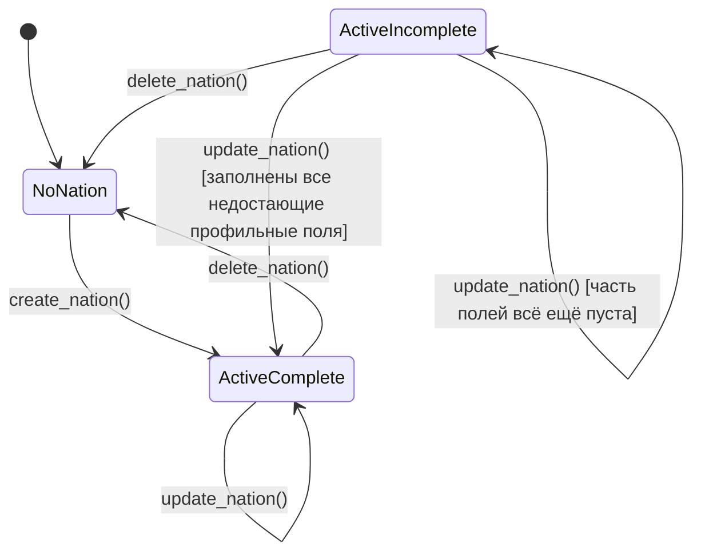
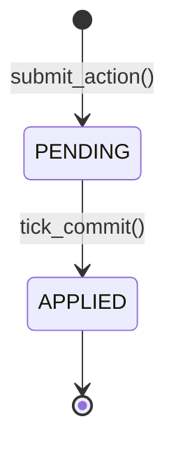
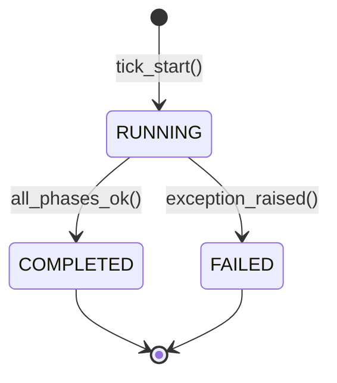

# 02_SYSTEM_SPECS / 00_core

> **Формат игровой даты (решение Project Owner 19.10.2026):** везде, где игроку показывается игровая дата, она пишется как «Месяц Год» (например, «Октябрь 2042»): название месяца с заглавной буквы в именительном падеже из `calendar.month_names`, год без ведущих нулей, без дня. Значение `game_date` в JSON остаётся ISO.
> **Изменения 1.4 (20.10.2026, версия 0.9.0 «Единый интерфейс»):** игрок государство удалить не может (Game Bible 00_core, п. 3): эндпоинт `DELETE /api/v1/nations/me`, окно `ModalConfirmDeleteNation`, кнопка «Удалить» и тактильный отклик на удаление убираются из сервера и клиента в единице 8 версии 0.9.0; `NationService.delete` остаётся внутренней операцией сервиса (на неё опираются хук удаления игрока и сброс мира, Часть 4). Вид и поведение окон определяет `docs/02_SYSTEM_SPECS/00_core_ui.md`; Часть 5 остаётся описанием состава панелей, и при расхождении побеждает 00_core_ui. Карточка государства показывает провинции названиями (столичная первая), без номеров провинций и без пола лидера; блок лидера и вкладка регистрации называются «Глава государства». Номер хода: целевое правило Game Bible — первый ход игры имеет номер 1 (январь 2040); пока не выполнена строка Backlog `00_core` «Ход 0 не должен существовать», формулы и значения Части 4 (в том числе $N_{turn} = 0$ как январь 2040) остаются в силе.
>
> **Изменения 1.3 (17.10.2026, версия 0.8.0 «Регистрация 2.0»):** государство получает полный набор описательных сведений (краткое название, девиз, описание, флаг; пол, портрет, биография и способ смены лидера; ссылка на гимн; столица и её название) — одиннадцать новых колонок `nations`, одна миграция. Количество стартовых провинций — ровно пять (`min = max = 5`). Новое правило различимости цветов в пространстве OKLab (Часть 3), проверяется внутри транзакции под блокировкой. Каталог готовых флагов и портретов (идентификаторы в конфиге, файлы в репозитории). Новые инварианты INV-11…INV-17, порядок проверок при создании расширен, новые коды ошибок, два новых и один расширенный эндпоинт. Регистрация в интерфейсе — четыре вкладки вместо двух. Исправлены устаревшие значения Части 4: `calendar.months_per_turn` (в конфиге 1, а не 3), добавлены пропущенные ключи `tick.heartbeat_interval_seconds`, `tick.health_max_heartbeat_age_seconds`, `calendar.month_names`. Изменения за пределами `00_core` — Приложение A.
>
> **Изменения 1.2 (03.10.2026):** добавлен раздел §3.8 «Точки расширения для модулей-сателлитов»: два именованных реестра ядра — слушатели смены владельца провинции и проверки регистрации государства (стадии `after_free`/`after_count`) — и правило одной транзакции (INV-M7 spec 01_map). Порядок проверок при создании государства уточнён до цепочки из Части 5 spec 01_map: существование → свобода → `after_free` → количество → `after_count` → создание; строка с прежним порядком обновлена.

## ЧАСТЬ 1: ДОМЕННАЯ МОДЕЛЬ

> Соответствие русской терминологии Bible и кодовых имён сущностей:
> «Государство» ⇔ `Nation` (не `State` — во избежание конфликта с термином FSM-состояния).

### `players`

| Поле         | Тип         | Ограничения               |
| ------------ | ----------- | ------------------------- |
| `id`         | UUID        | PK, default `uuid4()`     |
| `vk_user_id` | BIGINT      | UNIQUE, NOT NULL          |
| `created_at` | TIMESTAMPTZ | NOT NULL, default `now()` |

### `nations`

| Поле                  | Тип           | Ограничения                                                                  |
| --------------------- | ------------- | ---------------------------------------------------------------------------- |
| `id`                  | UUID          | PK, default `uuid4()`                                                        |
| `owner_player_id`     | UUID          | FK → `players.id`, **UNIQUE**, NOT NULL                                      |
| `name`                | VARCHAR(100)  | UNIQUE, NOT NULL (полное название)                                           |
| `color_hex`           | CHAR(7)       | UNIQUE, NOT NULL, формат `#RRGGBB`, хранится в верхнем регистре (INV-13)     |
| `leader_name`         | VARCHAR(100)  | NULLABLE (NULL только у государств, созданных до миграции профиля)           |
| `leader_title`        | VARCHAR(100)  | NULLABLE (то же)                                                             |
| `history_url`         | VARCHAR(2000) | NULLABLE (то же)                                                             |
| `short_name`          | VARCHAR(100)  | **UNIQUE**, **NOT NULL** (обязательное; NOT NULL с миграции 0012)            |
| `gender`              | VARCHAR(10)   | NULLABLE; значения `male` / `female` (NULL — у государств, созданных до 0.8.0) |
| `succession_type`     | VARCHAR(20)   | NULLABLE; значения `elections` / `appointment` / `criteria` / `inheritance`  |
| `motto`               | VARCHAR(100)  | NULLABLE (необязательное; пустое значение хранится как NULL)                 |
| `description`         | VARCHAR(200)  | NULLABLE (необязательное)                                                    |
| `leader_bio`          | VARCHAR(2000) | NULLABLE (необязательное)                                                    |
| `flag_id`             | VARCHAR(50)   | NULLABLE; идентификатор из `catalog.flag_ids` (обязательное при создании с 0.9.0; NULL — осознанное исключение для государств, созданных до 0.9.0) |
| `portrait_id`         | VARCHAR(50)   | NULLABLE; идентификатор из `catalog.portrait_ids` (обязательное при создании с 0.9.0; NULL — как у `flag_id`) |
| `anthem_url`          | VARCHAR(2000) | NULLABLE (не используется с 0.9.0; колонка и поле DTO временно сохраняются — снятие в бэклоге) |
| `capital_province_id` | INTEGER       | FK → `provinces.id`, `ON DELETE SET NULL`, NULLABLE (NULL — у государств, созданных до 0.8.0) |
| `capital_name`        | VARCHAR(100)  | NULLABLE (NULL — как у `capital_province_id`)                                |
| `created_turn`        | BIGINT        | как в 1.2 (колонка существует с миграции 0008; в этой версии не меняется)    |
| `created_at`          | TIMESTAMPTZ   | NOT NULL                                                                     |

`owner_player_id UNIQUE` — единственный способ жёстко гарантировать инвариант «1 игрок = 0 или 1 государство» на уровне БД, а не только в сервисном слое.

**Описательные сведения** — все поля после `color_hex` кроме `created_turn` и `created_at` (Bible §8). Уникальность на них не накладывается, кроме `short_name`; индексы на них не нужны. NULL допустим на уровне БД только ради государств, созданных до миграции и для необязательных полей; сервис при создании всегда записывает обязательные поля (INV-7, INV-12). Длины колонок равны верхним границам схемы конфига, поэтому любое валидное значение конфига помещается в колонку без новой миграции:

- `name`, `short_name`, `leader_name`, `leader_title`, `motto`, `capital_name` — 100 (`le=100`);
- `description` — 200 (`le=200`);
- `leader_bio`, `history_url`, `anthem_url` — 2000 (`le=2000`);
- `flag_id`, `portrait_id` — 50 (паттерн каталога `^[a-z0-9_]{1,50}$`);
- `gender` и `succession_type` — набор значений фиксирован кодом (не баланс), в конфиг не выносится.

**Миграция** (следующая после head `0010`, имя `0011_00_core_registration_2.py`) добавляет одиннадцать колонок (в SQLite — через `batch_alter_table`), уникальный индекс на `short_name` и внешний ключ `capital_province_id`; существующие данные не меняет. Между `nations` и `provinces` возникает циклическая ссылка (`provinces.nation_id` → `nations.id` и `nations.capital_province_id` → `provinces.id`): внешнему ключу столицы задаётся имя и `use_alter=True`; обе стороны NULLABLE. Порядок удаления государства не меняется: провинции освобождаются (INV-6), затем строка государства удаляется.

**Миграция 0012** (версия 0.10.0, единица 4a) делает `short_name` NOT NULL: перед ALTER пустые значения заполняются полным названием (`UPDATE nations SET short_name = name WHERE short_name IS NULL`), и если это нарушает уникальность, миграция падает. Пустых кратких названий в игре больше не существует.

### `provinces`

| Поле        | Тип     | Ограничения                                     |
| ----------- | ------- | ----------------------------------------------- |
| `id`        | INTEGER | PK, **не UUID** — присваивается данными карты (см. spec `01_map`) |
| `nation_id` | UUID    | FK → `nations.id`, NULLABLE (`NULL` = свободна) |

Строки таблицы создаются миграцией/фикстурой мира на старте проекта, не игроками.

### `scheduled_actions` (универсальный примитив «механического деятельного акта»)

| Поле          | Тип                        | Ограничения                                                 |
| ------------- | -------------------------- | ----------------------------------------------------------- |
| `id`          | UUID                       | PK                                                          |
| `nation_id`   | UUID                       | FK → `nations.id`, NULLABLE, `ON DELETE SET NULL` (миграция 0004: при удалении государства строка остаётся осиротевшей исторической записью) |
| `module_slug` | VARCHAR(50)                | NOT NULL — какой модуль владеет актом                       |
| `action_type` | VARCHAR(50)                | NOT NULL — тип акта внутри модуля                           |
| `payload`     | JSONB                      | NOT NULL — данные акта, интерпретируются модулем-владельцем |
| `turn_number` | BIGINT                     | NOT NULL — ход, на который запланирован                     |
| `status`      | ENUM(`PENDING`, `APPLIED`) | NOT NULL, default `PENDING`                                 |
| `created_at`  | TIMESTAMPTZ                | NOT NULL                                                    |
| `applied_at`  | TIMESTAMPTZ                | NULLABLE                                                    |

### `game_clock` (singleton-таблица, всегда ровно одна строка)

| Поле           | Тип         | Ограничения           |
| -------------- | ----------- | --------------------- |
| `id`           | SMALLINT    | PK, `CHECK (id = 1)`  |
| `current_turn` | BIGINT      | NOT NULL, default `0` |
| `last_tick_at` | TIMESTAMPTZ | NULLABLE              |
| `next_tick_at` | TIMESTAMPTZ | NOT NULL              |

`BIGINT` для счётчика хода — защита от переполнения на горизонте многолетней жизни проекта, а не потому что INT реально переполнится.

### `tick_log` (аудит-журнал, вне основной game-транзакции — см. Часть 2)

| Поле            | Тип                                    | Ограничения                 |
| --------------- | -------------------------------------- | --------------------------- |
| `id`            | INTEGER                                | PK                          |
| `turn_number`   | BIGINT                                 | NOT NULL                    |
| `started_at`    | TIMESTAMPTZ                            | NOT NULL                    |
| `finished_at`   | TIMESTAMPTZ                            | NULLABLE                    |
| `status`        | ENUM(`RUNNING`, `COMPLETED`, `FAILED`) | NOT NULL, default `RUNNING` |
| `error_message` | TEXT                                   | NULLABLE                    |

**Правило FK:** прямые внешние ключи из `scheduled_actions`/будущих таблиц-сателлитов допустимы только на `players.id`, `nations.id`, `provinces.id`. Ссылки на `scheduled_actions.id`, `game_clock.id`, `tick_log.id` из других модулей запрещены — это внутренняя бухгалтерия ядра, а не предметные сущности. Несколько записей с одинаковым `turn_number` допустимы (повторные попытки после сбоя); актуальной считается запись с наибольшим `id`.

### Константы кода (не баланс, в конфиг не выносятся)

Файл `backend/src/modules/_00_core/nation_enums.py`:

- `GENDERS = ("male", "female")` — «мужской», «женский».
- `SUCCESSION_TYPES = ("elections", "appointment", "criteria", "inheritance")` — «демократические выборы», «назначение игроком», «назначение по критериям», «наследование».

Русские подписи показывает клиент (Часть 5); сервер оперирует только кодами.

### Каталог картинок

Файл `backend/src/modules/_00_core/catalog.py` — единственное место, знающее, как идентификатор превращается в адрес: `flag_url(flag_id) -> str | None` возвращает `/assets/nations/flags/<id>.png`, `portrait_url(portrait_id) -> str | None` — `/assets/nations/portraits/<id>.png`, для `None` возвращают `None`. Файлы лежат в `frontend/public/assets/nations/flags/<id>.png` и `.../portraits/<id>.png`. Идентификаторы перечислены в конфиге (`catalog.flag_ids`, `catalog.portrait_ids`). Сервер проверяет только принадлежность идентификатора списку; существование файла проверяет тест CI (INV-15).

---

## ЧАСТЬ 2: ИНВАРИАНТЫ, FSM И МЕСТО В TICK DAG

### Инварианты

- **INV-1:** `nations.owner_player_id` уникален — игрок не может владеть двумя государствами одновременно.
- **INV-2:** `nations.name` и `nations.color_hex` уникальны глобально (UNIQUE-констрейнты БД, а не только проверка в сервисе).
- **INV-3:** Создание государства и закрепление провинций — одна атомарная транзакция; частичное закрепление недопустимо (нарушение любого условия откатывает всю операцию).
- **INV-4:** `scheduled_actions` неизменяемы после создания игроком; единственный разрешённый переход статуса — `PENDING → APPLIED`, и выполняет его только тик-оркестратор.
- **INV-5:** `game_clock.current_turn` мутируется исключительно оркестратором тика, монотонно, на `+1`.
- **INV-6:** Удаление государства не удаляет провинции — обнуляет их `nation_id` (провинции переходят в статус свободных).
- **INV-7:** При создании государства `leader_name`, `leader_title`, `history_url` обязательны и проходят проверки Части 3 (нормализация, длины, формат). Ни одно из трёх значений не может быть NULL у государства, созданного после миграции профиля.
- **INV-8:** При изменении `null` или отсутствие поля означает «не менять»; пустая строка (после нормализации) у **обязательного** поля — ошибка, а не очистка. Очистить можно только необязательные поля (INV-12).
- **INV-9:** Проверки профильных полей выполняются в `service.py` (единый источник; коды ошибок — Часть 5). DTO только типизирует поля.
- **INV-10:** На описательные сведения (кроме `short_name`) не накладывается уникальность; они не участвуют в расчётах Tick.
- **INV-11:** `nations.short_name` уникален глобально (UNIQUE-констрейнт БД) и не может быть NULL (NOT NULL с миграции 0012). Сравнение — точное, после нормализации; различие регистра пока считается различием (бэклог). При создании краткое название обязательно.
- **INV-12:** При создании обязательны: `short_name`, `gender`, `succession_type`, `capital_province_id`, `capital_name` — вместе с полями INV-7; с 0.9.0 также `flag_id` и `portrait_id` (пустое значение → `FLAG_INVALID`/`PORTRAIT_INVALID`; NULL у государств, созданных до 0.9.0, — осознанное исключение, PATCH его сохраняет). Необязательные поля (`motto`, `description`, `leader_bio`, `flag_id`, `portrait_id`, `anthem_url`) пустыми не хранятся: пустое значение после нормализации записывается как NULL.
- **INV-13 (различимость цветов):** Цвет государства при создании и при смене проходит проверку Части 3 (расстояние OKLab до цветов других государств и до цветов карты) под транзакционной блокировкой, так что два одновременных похожих цвета не проходят оба. Цвет нормализуется к верхнему регистру до всех проверок. Государства, существовавшие до 0.8.0, задним числом не проверяются.
- **INV-14 (столица):** `capital_province_id` при создании — одна из провинций, закрепляемых за этим государством; если не передан, равен первому элементу `province_ids` в том порядке, в котором список передан. Через PATCH не меняется; `capital_name` меняется. Состав провинций через PATCH не меняется. Модули, которые в будущем меняют владельца провинции, обязаны сами решить судьбу столицы (бэклог).
- **INV-15 (каталог):** `flag_id` и `portrait_id` — NULL либо элемент соответствующего списка конфига; пустой список конфига означает «выбор невозможен». Файл каждого идентификатора обязан существовать в `frontend/public/assets/nations/` — это проверяет тест CI, а не сервер.
- **INV-16:** Адреса картинок (`flag_url`, `portrait_url`) строятся только функциями `catalog.py`; ни сервисы, ни сателлиты не склеивают путь сами.
- **INV-17 (одиночные тексты):** однострочные тексты не содержат символов категорий Unicode `Cc`/`Cf`; многострочная биография допускает единственный управляющий символ — перевод строки `\n`.
- **Порядок проверок при создании:** INV-1 → поля сведений в фиксированном порядке (имя лидера, должность, пол, способ смены, ссылка на историю, ссылка на гимн, краткое название, девиз, описание, биография, флаг, портрет, название столицы; возвращается первая ошибка) → блокировка (PostgreSQL: `pg_advisory_xact_lock`, SQLite: не требуется) → INV-2 для названия → INV-11 для краткого названия → цвет (совпадение → `COLOR_TAKEN`; близость к цвету карты → `COLOR_TOO_CLOSE`; близость к цвету другого государства → `COLOR_TOO_CLOSE`) → существование провинций → свобода провинций → проверки сателлитов стадии `after_free` → количество провинций → проверки сателлитов стадии `after_count` → столица принадлежит выбранным провинциям (`CAPITAL_NOT_IN_PROVINCES`) → создание (точки расширения — §3.8).
- **Порядок проверок при изменении:** профильные поля (только переданные, в том же порядке) → блокировка → название → краткое название → цвет (только если новый цвет отличается от текущего; сравнение с остальными государствами, своё исключается) → запись.
- **INV-TICK-ATOMICITY:** Весь тик — одна транзакция БД. Необработанное исключение в любом обработчике любой фазы → откат целиком; `current_turn` не увеличивается; все `scheduled_actions` хода остаются `PENDING` и обрабатываются повторно на следующей попытке. Запись в `tick_log` выполняется отдельным соединением/autocommit — вне транзакции тика, — иначе при откате пропадёт и диагностика сбоя.
- **INV-FREQUENCY:** Проверка частоты акта — обязанность `00_core` (реализация), правило частоты — обязанность модуля-владельца (конфигурация). См. алгоритм в Части 3.

**Ключ блокировки.** `NATIONS_ADVISORY_LOCK_KEY = 0x4E4154494F4E53` («NATIONS» в ASCII; помещается в bigint, не совпадает с `ORDERS_ADVISORY_LOCK_KEY` модуля `04_orders`). Блокировка берётся вызовом `SELECT pg_advisory_xact_lock(:key)` только на диалекте `postgresql` — по образцу `04_orders/service.py`; на SQLite единственный писатель делает её лишней. Блокировка держится до конца транзакции; сервис не коммитит.

### FSM: жизненный цикл государства



`ActiveIncomplete` — производное состояние (хотя бы одно из полей `leader_name`, `leader_title`, `history_url`, `gender`, `succession_type` равно NULL), оно не хранится. Оно возможно только у строк, созданных до миграции; `create_nation()` ведёт сразу в `ActiveComplete`. Столица в определение не входит: у государства, созданного до 0.8.0, столицы нет и появиться она через редактирование не может (INV-14). Изменение сведений государства не является механическим деятельным актом: оно применяется немедленно и в `scheduled_actions` не попадает.

### FSM: жизненный цикл механического деятельного акта



### FSM: жизненный цикл тика



### Регистрация в Tick DAG

```python
class TickPhase(IntEnum):
    PHASE_1_ENVIRONMENT = 100
    PHASE_2_PRODUCTION  = 200
    PHASE_3_CONSUMPTION = 300
    PHASE_4_RESOLVE     = 400
    PHASE_5_EXPIRATION  = 500
```

`00_core` **не регистрирует ни одного обработчика** ни в одной из 5 фаз — ни одна игровая механика ядру не принадлежит. Единственная процедура ядра — `finalize_tick()`: инкремент `current_turn`, запись `last_tick_at`/`next_tick_at`, закрытие `tick_log`. Она вызывается оркестратором как финальный шаг **вне** цикла по `TickPhase`, строго после завершения обработчиков `PHASE_5_EXPIRATION`.

Описательные сведения государства (символика, руководство, ссылки, столица) в Tick не участвуют: нового шага расчёта и новой регистрации в `TickPhase` они не создают.

**Фазовые зависимости:**

- *Входящие:* отсутствуют — никакой модуль не мутирует таблицы `00_core` напрямую (только через `service.py` ядра).
- *Исходящие:* структурная (не фазовая) зависимость всех модулей-сателлитов от `00_core` — регистрация обработчика в реестре фаз обязана произойти до старта тика, иначе оркестратор модуль не вызовет.

### 3.8 Точки расширения для модулей-сателлитов (extension points)

Ядро никогда не импортирует модули-сателлиты: зависимость односторонняя. Чтобы сателлит мог встроиться в операции ядра, `00_core` владеет именованными реестрами (реализация — `modules/_00_core/hooks.py`), которые сателлиты заполняют при старте приложения.

**Реестр слушателей смены владельца провинции.**

- Контракт события — `OwnershipChange(province_id, prev_nation_id, new_nation_id, new_name, new_color, turn)`: замороженный dataclass; `turn` = `game_clock.current_turn` транзакции, выполняющей смену. У захвата `prev_nation_id = NULL` и `new_*` заполнены; у освобождения `prev_nation_id` = id удалённого государства, а все `new_*` = `NULL` — личность исчезнувшего государства доезжает до журнала через событие.
- Вызов: `NationService.create` (закрепление провинций) и `NationService.delete` (освобождение) вызывают `notify_ownership_changed(session, changes)` в **той же транзакции**, что и мутация `provinces.nation_id`, до commit (INV-M7 spec 01_map). Слушатели не коммитят сами. Ошибка любого слушателя откатывает всю операцию: государства нет, провинции свободны, записей журнала нет.
- Это единственная точка, через которую смена владельца становится видимой сателлитам: любая будущая операция, пишущая `provinces.nation_id` (завоевание, передача, освобождение), обязана идти через `notify_ownership_changed`. Админский сброс мира — осознанное исключение: он стирает мир целиком, а журнал очищает зарегистрированный хук сброса (см. ниже).

**Реестр проверок регистрации государства.**

- `NationService.create` выполняет проверки сателлитов на двух стадиях полного порядка Части 2/Части 5: `after_free` — сразу после проверки существования и свободы провинций, до проверки количества; `after_count` — сразу после проверки количества, до проверки столицы и записи строки государства.
- Проверка получает `AsyncSession` и загруженные строки `provinces`; отказ — доменное исключение со стабильным `code` и русским `message` (HTTP-статус — таблица соответствия в `main.py`, отсутствующий код → 500). Порядок вызова внутри стадии — порядок регистрации.

**Реестр хуков удаления игрока.**

- `register_player_delete_hook(name, fn)` — хук получает `(session, player_id)` и удаляет только строки собственного модуля этого игрока (инвариант суверенности данных); коммитить нельзя.
- `PlayerService.delete_player(session, player_id)` — админский инструмент для удаления тестовых игроков, необратимо. Всё выполняется в **одной транзакции** вызывающего кода (сервис не коммитит): (1) `NationService.delete` для государства игрока, если оно есть — провинции освобождаются, `scheduled_actions` сиротеют, записи об освобождении пишутся в журнал через `notify_ownership_changed` той же транзакцией; (2) все зарегистрированные хуки удаления в порядке регистрации — в отличие от хуков `nation_created`, SAVEPOINT на хук **нет**: ошибка любого хука откатывает удаление целиком (все-или-ничего); (3) строка `players`. Явные DELETE хуков — не запасной вариант: SQLite-тесты могут работать без включённых внешних ключей, поэтому каскады FK остаются лишь страховкой для PostgreSQL. Игрок не найден → `PLAYER_NOT_FOUND`. Удалённый пользователь ВК, снова открывший приложение, получает нового игрока через `get_or_create` — удаление не является баном.

**Общие правила реестров.**

- Записи именованные; повторная регистрация под тем же именем заменяет запись (идемпотентность: приложение может стартовать несколько раз в одном процессе тестов).
- Реестры предоставляют снимок/восстановление (`snapshot_extension_points`/`restore_extension_points`) для изоляции тестов — по образцу `AdminRegistry`.
- Сателлит `01_map` использует оба реестра при старте (spec 01_map, Часть 2): слушатель пишет `map_ownership_log`, проверки — «только суша» (`after_free`, `PROVINCE_NOT_LAND`) и «связная группа» (`after_count`, `STARTING_GROUP_NOT_CONNECTED`).
- Ядро работает с пустыми реестрами без деградации поведения — покрыто тестами.

**Хук сброса мира.** `admin_reset` в `00_core` выполняется в транзакции сброса через `AdminRegistry` (существующий механизм): хуки сателлитов вызываются в порядке, обратном регистрации, до модуля `00_core`. Сброс освобождает провинции массовым UPDATE без событий владельца — журнал владения зачищает собственный хук сателлита (для `01_map` — `DELETE FROM map_ownership_log`), поэтому после сброса журнал пуст, `current_turn = 0`, провинции свободны. Строки государств удаляются вместе со всеми сведениями (включая столицу): внешний ключ `capital_province_id` не мешает, потому что государства удаляются раньше любого удаления провинций (если провинции удаляются, `ON DELETE SET NULL` страхует).

---

## ЧАСТЬ 3: МАТЕМАТИЧЕСКИЙ АППАРАТ

Формульный аппарат `00_core` минимален по конструкции: ядро не считает игровые показатели (это зона модулей-сателлитов), поэтому формул с делением здесь нет и защита от деления на ноль не применима к текущей части — общий паттерн для будущих модулей: `x / max(y, ε)`.

**Момент следующего тика:**
$$
t_{next} = \min\{\, t \in T_{tick} \mid t > t_{now} \,\}
$$
где $T_{tick}$ — множество локальных календарных моментов `tick.tick_time` (строгий формат `HH:MM`) в зоне `tick.tick_timezone`. `next_tick_at` — ближайшее наступление этого времени суток строго после `t_{now}`, вычисленное по локальной календарной дате (никогда не «+24h»): переходы на летнее/зимнее время сдвигают UTC-момент тика, а локальное время остаётся фиксированным. Следствие: ручной запуск тика не сдвигает суточное расписание.

**Игровая дата:**
$$
M_{total} = Y_{epoch} \times 12 + (m_{epoch} - 1) + N_{turn} \times R_{months}
$$
$$
D_{game} = \mathrm{date}\bigl(\lfloor M_{total} / 12 \rfloor,\; M_{total} \bmod 12 + 1,\; 1\bigr)
$$
где $D_{epoch}$ = `calendar.epoch_start_date` (схема требует первое число месяца, поэтому день результата всегда 1), $N_{turn}$ = `game_clock.current_turn`, $R_{months}$ = `calendar.months_per_turn`. Округление не нужно — все операнды целые; отрицательный $N_{turn}$ — `ValueError`, а итог за пределами `date.max` прижимается к `9999-12-01` вместо ошибки. Первый ход ($N_{turn} = 0$, в том числе сразу после сброса мира) — январь 2040 года.

Игроку дата показывается как «Месяц Год»: `format_game_date` берёт название из `calendar.month_names` (ровно 12 имён, январь первым, без дублей), делает первую букву заглавной и добавляет год без ведущих нулей — `Январь 2040`, `Февраль 2040`, `Январь 2041` (ход 12). День не показывается (он всегда 1). В JSON дата остаётся ISO в `game_date`, текстовая форма приезжает отдельным полем `game_date_text`.

**Свежесть `vk_ts` (Session Auth):**
$$
|\,t_{now} - t_{vk\_ts}\,| \le W_{freshness}
$$
где $W_{freshness}$ = `vk_ts_freshness_window_minutes × 60` (секунды). Модуль абсолютного значения закрывает сразу два случая: устаревший запрос (replay-атака) и запрос с меткой из будущего (рассинхрон часов/подделка).

**Проверка частоты механического акта (INV-FREQUENCY):**
$$
\text{Allow} \iff N_{used}(P, M, A, T) < N_{max}(F)
$$
где $N_{used}$ — число уже существующих `scheduled_actions` для государства $P$, модуля $M$, типа акта $A$ на ходу $T$ (для правила `ONCE_PER_GAME` фильтр по ходу $T$ снимается — считается за всю историю); $N_{max}(F)$ определяется правилом частоты: `ONCE_PER_TURN → 1`, `ONCE_PER_GAME → 1` (без фильтра по ходу), `MULTIPLE_PER_TURN → cap` (числовой лимит модуля-владельца), `UNLIMITED → ∞`.

### Профильные поля государства

Формул с делением здесь нет, защита от деления на ноль не применима. Округления нет.

**Нормализация:** $t = s.\mathrm{strip}()$ (Unicode-пробелы). Длина считается в кодовых точках Unicode ($\lvert t \rvert$ = `len(t)`).

**Однострочное текстовое поле** (полное название, краткое название, имя лидера, должность лидера, девиз, описание, название столицы):
$$
\text{valid}(s) \iff L_{\min} \le \lvert t \rvert \le L_{\max} \;\wedge\; \forall c \in t:\ \mathrm{cat}(c) \notin \{\mathrm{Cc}, \mathrm{Cf}\}
$$
Поле однострочное: управляющие символы (включая перевод строки) и невидимые символы форматирования (категории Unicode `Cc`, `Cf`) недопустимы. Пределы берутся из конфига: `nation.nation_name_*`, `nation.short_name_*`, `nation.leader_name_*`, `nation.leader_title_*`, `nation.capital_name_*`; у девиза и описания нижней границы нет ($L_{\min} = 0$ после нормализации: пустое значение — «нет значения», хранится как NULL), верхние — `nation.motto_max_length`, `nation.description_max_length`. Значение хранится в нормализованном виде (после `strip`).

**Многострочное текстовое поле** (биография лидера): сначала `\r\n` и одиночный `\r` заменяются на `\n`, подряд идущие три и более `\n` сворачиваются в два (между абзацами — не больше одной пустой строки), затем `strip`; допустимы символы, кроме категорий `Cc`/`Cf`, за исключением перевода строки `\n`; длина — в кодовых точках, `\n` считается за один; верхняя граница — `nation.leader_bio_max_length`, применяется к тексту после нормализации; пустое значение — NULL.

**Ссылка на историю:** $u = \mathrm{trim}(s)$, разбор — `urllib.parse.urlsplit`:
$$
\text{valid\_url}(u) \iff \lvert u \rvert \le L_{url} \;\wedge\; \text{scheme}=\texttt{https} \;\wedge\; \text{host}\in H \;\wedge\; \text{port},\ \text{userinfo},\ \text{query},\ \text{fragment}=\varnothing \;\wedge\; \text{path} = \texttt{/@}\,\text{slug}
$$
где $H$ — `nation.history_url_allowed_hosts` (в 0.8.0: `vk.com`, `vk.ru`, `m.vk.com`), хост сравнивается в нижнем регистре, $L_{url}$ — `nation.history_url_max_length`. Путь ($\text{slug}$ — название статьи) должен соответствовать регулярному выражению `^/@[^/\s]+$` (адрес статьи ВКонтакте: знак `@`, затем название без слэшей и пробелов). Пробелы и управляющие символы внутри адреса недопустимы. Ошибка разбора (`ValueError`, например некорректный порт) считается невалидной ссылкой. Значение хранится в том виде, в котором принято после удаления внешних пробелов.

**Ссылка на гимн** (поле не используется с 0.9.0 — интерфейс его не предлагает; колонка, поле DTO и проверка временно сохраняются): $u = \mathrm{trim}(s)$; пустое значение — «нет ссылки» (NULL). Иначе:
$$
\text{valid\_anthem}(u) \iff \lvert u \rvert \le L_{anthem} \;\wedge\; \text{scheme}=\texttt{https} \;\wedge\; \text{host}\in H_{a} \;\wedge\; \text{port},\ \text{userinfo}=\varnothing \;\wedge\; u\ \text{не содержит пробелов и символов категорий Cc/Cf}
$$
где $H_a$ — `nation.anthem_url_allowed_hosts`, $L_{anthem}$ — `nation.anthem_url_max_length`. Путь, параметры и фрагмент не проверяются: формат ссылок ВКонтакте на музыку не подтверждён (NAT-0, N4). Это сознательно мягкая проверка; ужесточение — после исследования формата.

**Известное ограничение:** формат ссылок проверяется, содержимое — нет. Ссылка на чужую статью или на страницу автора `vk.com/@имя` формат проходит (Bible §8, `out_of_scope`).

**Частичное изменение (PATCH):** обязательные поля: не-`null` проходит те же проверки, `null` или отсутствие — «не менять», пустая строка — ошибка; необязательные поля: не-`null` проходит проверки, `null` или отсутствие — «не менять», пустая строка (после нормализации) — «очистить» (запись NULL).

### Различимость цветов (INV-13)

**Перевод цвета в OKLab.** Вход — `#RRGGBB` (регистр любой). Каналы $c \in \{R, G, B\}$ переводятся в линейный sRGB:
$$
c' = c/255,\qquad c_{lin} = \begin{cases} c'/12.92, & c' \le 0.04045 \\ \bigl((c'+0.055)/1.055\bigr)^{2.4}, & c' > 0.04045 \end{cases}
$$
Затем в конусный отклик и кубический корень:
$$
\begin{aligned}
l &= 0.4122214708\,R + 0.5363325363\,G + 0.0514459929\,B\\
m &= 0.2119034982\,R + 0.6806995451\,G + 0.1073969566\,B\\
s &= 0.0883024619\,R + 0.2817188376\,G + 0.6299787005\,B
\end{aligned}
\qquad l_c=\sqrt[3]{l},\; m_c=\sqrt[3]{m},\; s_c=\sqrt[3]{s}
$$
(здесь $R, G, B$ — линейные значения). Координаты OKLab:
$$
\begin{aligned}
L &= 0.2104542553\,l_c + 0.7936177850\,m_c - 0.0040720468\,s_c\\
a &= 1.9779984951\,l_c - 2.4285922050\,m_c + 0.4505937099\,s_c\\
b &= 0.0259040371\,l_c + 0.7827717662\,m_c - 0.8086757660\,s_c
\end{aligned}
$$

**Расстояние:**
$$
d(c_1, c_2) = \sqrt{(L_1-L_2)^2 + (a_1-a_2)^2 + (b_1-b_2)^2}
$$
Чёрный и белый находятся на расстоянии 1.0. Деления нет, защита от деления на ноль не применима; округления нет (сравнение с порогом — на полной точности `float`).

**Решение.** Для нового цвета $c$ (в верхнем регистре) и множеств $O$ — цвета других государств, $R$ — цвета карты из `color.reserved`:
$$
\text{status}(c) = \begin{cases}
\texttt{TAKEN}, & \exists\, o \in O:\ o = c\\
\texttt{TOO\_CLOSE}, & \exists\, r \in R:\ d(c, r) < D_{res}\\
\texttt{TOO\_CLOSE}, & \exists\, o \in O:\ d(c, o) < D_{nat}\\
\texttt{OK}, & \text{иначе}
\end{cases}
$$
где $D_{nat}$ = `color.min_distance_nations`, $D_{res}$ = `color.min_distance_reserved`. Равенство порогу — допустимо (строгое «меньше»). Реализация — чистые функции в `backend/src/modules/_00_core/color_policy.py` (`hex_to_oklab`, `oklab_distance`; схема конфига импортирует их же). Цвета государств читаются из БД в той же транзакции, что и запись, после взятия блокировки (INV-13).

**Тестовые векторы** (допуск по каждому значению $10^{-5}$):

- `#000000` → (0.0, 0.0, 0.0); `#FFFFFF` → (1.0, 0.0, 0.0); `#8C8C8C` → (0.640087, 0.0, 0.0); `#FF0000` → (0.627955, 0.224863, 0.125846); `#00FF00` → (0.866440, −0.233888, 0.179498); `#141E26` → (0.229243, −0.009648, −0.018895).
- $d$(`#000000`, `#FFFFFF`) = 1.000000; $d$(`#FF0000`, `#00FF00`) = 0.519813; $d$(`#0C7CF4`, `#2B2DB0`) = 0.207907.
- $d$(`#8C8C8C`, `#8F8F8F`) = 0.009954; $d$(`#BE1253`, `#C01355`) = 0.005012 — оба меньше любого порога конфига (отказ).
- $d$(`#8C8C8C`, `#9A9A9A`) = 0.046136; $d$(`#8C8C8C`, `#A0A0A0`) = 0.065670 — при порогах 0.08 оба отказ.
- $d$(`#ff0000`, `#FF0000`) = 0 (регистр не влияет).

**Палитра.** Палитра из 36 цветов в `color.palette` подобрана заранее жадным алгоритмом «максимальный минимум» (не вычисляется при работе сервера). Схема конфига проверяет, что любые два цвета палитры различимы не хуже $D_{nat}$, а любой цвет палитры — не хуже $D_{res}$ до каждого цвета карты; в поставляемом конфиге минимальное расстояние в палитре 0.1015, до цветов карты 0.1002. Пороги и палитру можно менять правкой конфига (быстрый трек «А»), CI не пропустит палитру, нарушающую собственные пороги.

---

## ЧАСТЬ 4: СПЕЦИФИКАЦИЯ КОНФИГУРАЦИИ

Колонка «значение» — то, что записано в `configs/00_core.yaml` на момент версии 0.8.0 (в схеме значений по умолчанию нет, кроме двух ключей `tick.heartbeat_*`).

| Ключ                                       | Тип                | Единица          | min       | max          | значение (0.8.0) |
| ------------------------------------------ | ------------------ | ---------------- | --------- | ------------ | ---------------- |
| `tick.tick_time`                           | str `HH:MM` 24ч   | локальное время  | —         | —            | **"00:00"**      |
| `tick.tick_timezone`                       | str (IANA zone)    | —                | —         | —            | **"Europe/Moscow"** |
| `tick.tick_interval_hours`                 | int                | часы (legacy)    | 1         | 168          | **24**           |
| `tick.retry_delay_seconds`                 | int                | секунды          | 1         | 3600         | **60**           |
| `tick.heartbeat_interval_seconds`          | int                | секунды          | 1         | 300          | **30** (default схемы 30) |
| `tick.health_max_heartbeat_age_seconds`    | int                | секунды          | 60        | 3600         | **180** (default схемы 180) |
| `auth.vk_ts_freshness_window_minutes`      | int                | минуты           | 1         | 120          | **30**           |
| `auth.jwt_ttl_minutes`                     | int                | минуты           | 5         | 1440         | **60**           |
| `nation.nation_name_min_length`            | int                | символы          | 1         | 10           | **2**            |
| `nation.nation_name_max_length`            | int                | символы          | 1         | 100          | **60**           |
| `nation.short_name_min_length`             | int                | символы          | 1         | 10           | **2**            |
| `nation.short_name_max_length`             | int                | символы          | 1         | 100          | **20**           |
| `nation.min_provinces_per_nation`          | int                | шт.              | 0         | 10           | **5**            |
| `nation.max_provinces_per_nation`          | int                | шт.              | 1         | 200          | **5**            |
| `nation.leader_name_min_length`            | int                | символы          | 1         | 10           | **2**            |
| `nation.leader_name_max_length`            | int                | символы          | 1         | 100          | **60**           |
| `nation.leader_title_min_length`           | int                | символы          | 1         | 10           | **2**            |
| `nation.leader_title_max_length`           | int                | символы          | 1         | 100          | **60**           |
| `nation.motto_max_length`                  | int                | символы          | 1         | 100          | **50**           |
| `nation.description_max_length`            | int                | символы          | 1         | 200          | **150**          |
| `nation.leader_bio_max_length`             | int                | символы          | 1         | 2000         | **500**          |
| `nation.capital_name_min_length`           | int                | символы          | 1         | 10           | **2**            |
| `nation.capital_name_max_length`           | int                | символы          | 1         | 100          | **40**           |
| `nation.history_url_max_length`            | int                | символы          | 30        | 2000         | **200**          |
| `nation.history_url_allowed_hosts`         | list[str]          | имена хостов     | 1 элемент | 10 элементов | **["vk.com", "vk.ru", "m.vk.com"]** |
| `nation.anthem_url_max_length`             | int                | символы          | 30        | 2000         | **200**          |
| `nation.anthem_url_allowed_hosts`          | list[str]          | имена хостов     | 1 элемент | 10 элементов | **["vk.com", "vk.ru", "m.vk.com"]** |
| `color.min_distance_nations`               | float              | расстояние OKLab | 0.02      | 0.5          | **0.08**         |
| `color.min_distance_reserved`              | float              | расстояние OKLab | 0.02      | 0.5          | **0.08**         |
| `color.reserved`                           | list[{name, hex}]  | —                | 1 элемент | 20 элементов | **4 цвета карты** |
| `color.palette`                            | list[str `#RRGGBB`]| —                | 1 элемент | 60 элементов | **36 цветов**    |
| `catalog.flag_ids`                         | list[str]          | идентификаторы   | 0 элементов | 200 элементов | **[]** до Issue 11 |
| `catalog.portrait_ids`                     | list[str]          | идентификаторы   | 0 элементов | 200 элементов | **[]** до Issue 11 |
| `calendar.epoch_start_date`                | date (ISO 8601, день = 1) | —         | —         | —            | **"2040-01-01"** |
| `calendar.months_per_turn`                 | int                | игровые месяцы   | 1         | 12           | **1**            |
| `calendar.month_names`                     | list[str]          | названия         | ровно 12  | ровно 12     | январь … декабрь |

`tick_interval_hours=24` и `vk_ts_freshness_window_minutes=30` — не мои предположения, а уже зафиксированные в `README.md` («суточный ход») и `development_workflow.md` («свежестью ≤ 30 минут») значения; я их перенёс без изменений. С переходом на суточный тик в фиксированное локальное время `tick_interval_hours` остаётся в конфиге только для миграции 0001 (посев первого `next_tick_at` на свежей БД) — планировщик и `finalize_tick()` используют `tick_time`/`tick_timezone`. `tick.retry_delay_seconds` — пауза перед повторной попыткой тика после сбоя. `tick.heartbeat_interval_seconds` — шаг ожидания планировщика; `tick.health_max_heartbeat_age_seconds` — порог «живости» для `GET /api/v1/health` (схема требует, чтобы он превышал `retry_delay_seconds + heartbeat_interval_seconds`).

Число стартовых провинций задано двумя ключами `min`/`max`, оба равны 5 (решение Project Owner 17.10.2026): ключи остаются раздельными, чтобы число могло позже зависеть от бонусов.

**Перекрёстные правила схемы:**

- `*_min_length ≤ *_max_length` для названия, краткого названия, лидера, должности, столицы; `short_name_max_length ≤ nation_name_max_length`; `min_provinces_per_nation ≤ max_provinces_per_nation`.
- Хосты в `history_url_allowed_hosts` и `anthem_url_allowed_hosts` — в нижнем регистре, без схемы, порта и пути, валидные имена хостов, без дублей.
- Верхние границы `le` текстовых лимитов не больше длин колонок в БД (100 / 100 / 100 / 100 / 200 / 2000 / 2000 / 2000, см. Часть 1); это проверяет тест `test_configs_validity.py`.
- `color.reserved[].hex` и `color.palette[]` — формата `#RRGGBB`; палитра без дублей (регистр не учитывается); любые два цвета палитры различимы не хуже `min_distance_nations`; любой цвет палитры различим с каждым цветом `color.reserved` не хуже `min_distance_reserved`.
- `catalog.*_ids` — паттерн `^[a-z0-9_]{1,50}$`, без дублей, список может быть пустым.
- `tick.health_max_heartbeat_age_seconds > tick.retry_delay_seconds + tick.heartbeat_interval_seconds`.
- Все ключи, кроме двух ключей `tick.heartbeat_*`, обязательны (значений по умолчанию в схеме нет): пропущенный ключ ломает запуск.

**Сверка с картой (тест CI, не схема).** Тест `test_configs_validity.py` проверяет, что цвета `colors.neutral_province`, `colors.sea`, `colors.outside`, `colors.hover` из `configs/01_map.yaml` присутствуют среди `color.reserved[].hex` (регистр не учитывается). Так правка цвета карты без правки резерва ломает сборку, а не молча открывает цвет государствам.

---

## ЧАСТЬ 5: СЕТЕВОЙ И UI КОНТРАКТ

### FastAPI эндпоинты

| Метод  | Путь                       | Авторизация       | Request DTO                    | Response DTO        | Код                 |
| ------ | -------------------------- | ----------------- | ------------------------------ | ------------------- | ------------------- |
| POST   | `/api/v1/auth/vk`          | нет (точка входа) | `VkAuthRequest{launch_params}` | `AuthResponseDTO`   | 200                 |
| GET    | `/api/v1/players/me`       | Bearer            | —                              | `PlayerDTO`         | 200                 |
| GET    | `/api/v1/nations/me`       | Bearer            | —                              | `NationDTO`         | 200 / 404           |
| GET    | `/api/v1/nations/rules`    | Bearer            | —                              | `NationRulesDTO`    | 200                 |
| GET    | `/api/v1/nations/{nation_id}` | Bearer         | —                              | `NationPublicDTO`   | 200 / 404           |
| POST   | `/api/v1/nations/color-check` | Bearer         | `ColorCheckRequest`            | `ColorCheckDTO`     | 200 / 422           |
| POST   | `/api/v1/nations`          | Bearer            | `NationCreateRequest`          | `NationDTO`         | 201 / 409 / 422     |
| PATCH  | `/api/v1/nations/me`       | Bearer            | `NationUpdateRequest`          | `NationDTO`         | 200 / 409 / 422     |
| GET    | `/api/v1/provinces`        | Bearer            | `?ids=&free_only=`             | `List[ProvinceDTO]` | 200                 |
| GET    | `/api/v1/game-clock`       | Bearer            | —                              | `GameClockDTO`      | 200                 |

`DELETE /api/v1/nations/me` отменён (Изменения 1.4) и снят в единице 8 версии 0.9.0 вместе с тестами и клиентским вызовом: игрок государство не удаляет; `NationService.delete` остаётся внутренней операцией сервиса (хук удаления игрока, сброс мира).

`POST /api/v1/nations/color-check` — подсказка для интерфейса при вводе HEX: проверяет цвет теми же функциями Части 3, но без блокировки и без записи, поэтому ответ `OK` не гарантирует успех создания (окончательное решение принимает `POST /api/v1/nations` под блокировкой). Свой собственный цвет (если у игрока уже есть государство) из сравнения исключается. Неверный формат `color_hex` — стандартный 422.

### DTO

```python
AuthResponseDTO   = { access_token: str, token_type: "bearer", expires_in: int, player: PlayerDTO }
PlayerDTO         = { id: UUID, vk_user_id: int, created_at: datetime }
NationDTO         = { id: UUID, owner_player_id: UUID, created_at: datetime,
                      name: str, short_name: str, color_hex: str,
                      motto: str | None, description: str | None,
                      flag_id: str | None, flag_url: str | None,
                      province_ids: list[int],
                      capital_province_id: int | None, capital_name: str | None,
                      leader_name: str | None, gender: str | None, leader_title: str | None,
                      leader_bio: str | None, portrait_id: str | None, portrait_url: str | None,
                      succession_type: str | None,
                      history_url: str | None, anthem_url: str | None,
                      level: int, judge_rating: int }   # level и judge_rating владельца — с версии 0.9.0 (единица 14)
                      # None у обязательных полей — только у государств, созданных до миграции 0.8.0 (или до миграции профиля);
                      # None у необязательных — «не задано»
NationPublicDTO   = { id: UUID, created_at: datetime,
                      name: str, short_name: str, color_hex: str,
                      motto: str | None, description: str | None,
                      flag_id: str | None, flag_url: str | None,
                      province_ids: list[int],
                      capital_province_id: int | None, capital_name: str | None,
                      leader_name: str | None, leader_title: str | None,
                      leader_bio: str | None, portrait_id: str | None, portrait_url: str | None,
                      history_url: str | None,
                      level: int, judge_rating: int }
                      # публичные сведения о чужом государстве (Bible 00_core, п. 7, версия 0.9.0, единица 14).
                      # НЕ содержит: owner_player_id, gender, succession_type, anthem_url, vk-идентификаторов.
                      # Тест: ключи ответа точно равны перечню выше. Неизвестный id → 404 NATION_NOT_FOUND.
                      # level и judge_rating — поля игрока-владельца (`players`), читаются в 00_core.
NationCreateRequest = { name: str, short_name: str, color_hex: str,
                        motto: str | None, description: str | None, flag_id: str | None,
                        province_ids: list[int], capital_province_id: int | None, capital_name: str,
                        leader_name: str, gender: str, leader_title: str, leader_bio: str | None,
                        portrait_id: str | None, succession_type: str,
                        history_url: str, anthem_url: str | None }
NationUpdateRequest = { name: str | None, short_name: str | None, color_hex: str | None,
                        motto: str | None, description: str | None, flag_id: str | None,
                        capital_name: str | None,
                        leader_name: str | None, gender: str | None, leader_title: str | None,
                        leader_bio: str | None, portrait_id: str | None, succession_type: str | None,
                        history_url: str | None, anthem_url: str | None }
                        # None/отсутствие = не менять; "" у необязательных = очистить; "" у обязательных = ошибка.
                        # province_ids и capital_province_id не объявлены (INV-14): лишние ключи игнорируются, как раньше.
CatalogItemDTO    = { id: str, url: str }
NationRulesDTO    = { name_min_length: int, name_max_length: int,
                      short_name_min_length: int, short_name_max_length: int,
                      motto_max_length: int, description_max_length: int,
                      leader_name_min_length: int, leader_name_max_length: int,
                      leader_title_min_length: int, leader_title_max_length: int,
                      leader_bio_max_length: int,
                      capital_name_min_length: int, capital_name_max_length: int,
                      history_url_max_length: int, history_url_allowed_hosts: list[str],
                      anthem_url_max_length: int, anthem_url_allowed_hosts: list[str],
                      min_provinces: int, max_provinces: int,
                      palette: list[str],
                      flags: list[CatalogItemDTO], portraits: list[CatalogItemDTO],
                      genders: list[str], succession_types: list[str] }
                      # значения из конфига и кода, для подсказок и выбора в форме; пороги цвета клиенту не нужны
ColorCheckRequest = { color_hex: str }
ColorCheckDTO     = { status: "OK" | "TAKEN" | "TOO_CLOSE" }
ProvinceDTO       = { id: int, nation_id: UUID | None }
GameClockDTO      = { current_turn: int, game_date: str, game_date_text: str, next_tick_at: datetime }
                                                                                             # game_date — ISO; game_date_text — «Месяц Год»
ErrorResponse      = { detail: str, code: str }
```

`color_hex` валидируется regex-паттерном `^#[0-9A-Fa-f]{6}$` на уровне DTO — это не балансовое число, поэтому в YAML не выносится. Длина названия также проверяется на уровне DTO по конфигу. Ошибки типов и формата DTO (`color_hex`, длина названия, тело запроса) FastAPI возвращает в стандартном формате 422; описательные поля государства проверяет сервис, и их ошибки приходят в формате `ErrorResponse`. Ответы всегда содержат `color_hex` в верхнем регистре для новых и изменённых цветов; у старых записей возвращается как хранится.

### Коды ошибок (`ErrorResponse.code`)

| code | HTTP | Когда |
| --- | --- | --- |
| `NAME_TAKEN` | 409 | название государства занято |
| `SHORT_NAME_TAKEN` | 409 | краткое название занято |
| `COLOR_TAKEN` | 409 | цвет государства занят (совпадает с цветом другого государства) |
| `COLOR_TOO_CLOSE` | 409 | цвет слишком похож на цвет другого государства или на цвет карты |
| `PROVINCE_TAKEN` | 409 | провинция уже закреплена за другим государством |
| `PROVINCE_NOT_FOUND` | 404 | провинции не существует |
| `PROVINCE_COUNT_OUT_OF_RANGE` | 422 | количество провинций вне границ конфига |
| `NATION_ALREADY_EXISTS` | 409 | игрок уже владеет государством |
| `NATION_NOT_FOUND` | 404 | у игрока нет государства |
| `LEADER_NAME_INVALID` | 422 | имя лидера пусто, вне границ длины или содержит недопустимые символы |
| `LEADER_TITLE_INVALID` | 422 | то же для должности лидера |
| `GENDER_INVALID` | 422 | пол не из набора `GENDERS` или пуст |
| `SUCCESSION_INVALID` | 422 | способ смены лидера не из набора `SUCCESSION_TYPES` или пуст |
| `SHORT_NAME_INVALID` | 422 | краткое название пусто, вне границ длины или содержит недопустимые символы |
| `MOTTO_INVALID` | 422 | девиз длиннее лимита или содержит недопустимые символы |
| `DESCRIPTION_INVALID` | 422 | описание длиннее лимита или содержит недопустимые символы |
| `LEADER_BIO_INVALID` | 422 | биография длиннее лимита или содержит недопустимые символы |
| `FLAG_INVALID` | 422 | флаг не выбран (при создании обязателен) или идентификатор вне каталога |
| `PORTRAIT_INVALID` | 422 | портрет не выбран (при создании обязателен) или идентификатор вне каталога |
| `HISTORY_URL_INVALID` | 422 | ссылка пуста, длиннее лимита или не проходит формат (`detail` называет причину) |
| `ANTHEM_URL_INVALID` | 422 | ссылка на гимн длиннее лимита или не проходит проверку Части 3 |
| `CAPITAL_NAME_INVALID` | 422 | название столицы пусто, вне границ длины или содержит недопустимые символы |
| `CAPITAL_NOT_IN_PROVINCES` | 422 | столица не входит в список выбранных провинций |
| `INVALID_SIGNATURE` | 401 | подпись launch-параметров неверна |
| `TIMESTAMP_EXPIRED` | 401 | `vk_ts` вне окна свежести |
| `UNAUTHORIZED` | 401 | отсутствует или недействителен Bearer-токен |
| `GAME_CLOCK_NOT_FOUND` | 404 | не инициализирован `game_clock` |
| `FREQUENCY_CAP_EXCEEDED` | — | превышен лимит частоты механического акта (внутренний, наружу через эндпоинты `00_core` не отдаётся) |

Статусы кодов регистрируются в таблице соответствия `main.py`; код без записи в ней вернулся бы как 500. Тексты `detail` новых кодов — на английском, как у прежних кодов ядра; русские тексты для игрока выбирает клиент по `code` (таблица ниже).

### Панели VKUI (desktop; тексты на русском; окно, кроме карты, ≤ 910 px по ширине)

> Вид и поведение окон — по `docs/02_SYSTEM_SPECS/00_core_ui.md` (при расхождении побеждает он); ниже — состав панелей `00_core`.

- **Auth-gate** — невидимая, `ScreenSpinner` на время резолва `/auth/vk`.
- **`PanelCreateNation` — контейнер из четырёх вкладок.** Номер текущей вкладки (1…4) и все введённые значения хранятся в контейнере: переключение вкладок их не теряет и ничего не отправляет на сервер. Черновик дополнительно запоминается в `sessionStorage` (обёртка `try/catch`, интерфейс обязан работать и без него) и стирается после успешной регистрации; на сервере черновики не хранятся.
  - **Вкладка 1 «Основные данные и символика»:** `FormItem`(полное название, `Input`, счётчик длины), `FormItem`(краткое название, `Input`), `FormItem`(девиз, `Input`, необязательно), `FormItem`(описание, `Input`, необязательно), `FormItem`(цвет: сетка готовой палитры из `rules.palette` и поле ввода HEX; при вводе — запрос `POST /nations/color-check` с задержкой около 400 мс и подсказка: «цвет свободен» / «цвет занят» / «слишком похож на цвет другого государства или карты»), `FormItem`(флаг: сетка из `rules.flags`, обязательный — первый элемент каталога выбран заранее).
  - **Вкладка 2 «Глава государства»:** `FormItem`(портрет: сетка из `rules.portraits`, обязательный — первый элемент каталога выбран заранее), `FormItem`(имя лидера), `FormItem`(пол — два варианта «мужской»/«женский»), `FormItem`(должность лидера), `FormItem`(биография, `Textarea`, необязательно, счётчик длины), способ смены лидера — четыре крупные кнопки-карточки с иконками и кратким описанием: «Демократические выборы» (`elections`), «Назначение игроком» (`appointment`), «Назначение по критериям» (`criteria`), «Наследование» (`inheritance`); под ними подпись «Пока без последствий в игре».
  - **Вкладка 3 «История»:** одно поле — `FormItem`(ссылка на статью ВКонтакте, `Input`, пометка «обязательно», подсказка формата `https://vk.com/@название-статьи`); поля гимна нет.
  - **Вкладка 4 «Территории»:** чипы выбранных провинций (порядок выбора сохраняется; чип снимается по одному) и кнопка «Выбрать на карте», открывающая `ProvincePicker` из `01_map` (`ModalPage` с картой: клик по свободной сухопутной провинции выбирает/снимает её, морские и занятые отказывают с подсказкой; «Готово» после `POST /map/starting-group/check`; выбрать можно ровно `rules.max_provinces` провинций, окно сообщает «выбрано N из 5» — число берётся из правил). Столица: правая кнопка мыши по выбранной провинции помечает её столицей, повторная по ней же — снимает отметку; столица одна; клиент пытается погасить стандартное контекстное меню (`preventDefault`), но не полагается на это; рядом с каждым чипом — видимая кнопка «Сделать столицей»/«Снять отметку». Если отметки нет, столицей считается первая выбранная провинция (клиент показывает это подписью). `FormItem`(название столицы, `Input`) подставляет название отмеченной (или первой) провинции, пока игрок не изменил его вручную; после правки игроком не перезаписывается.
  - Навигация: кнопки-стрелки «назад»/«вперёд» (`IconButton`, иконки `@vkontakte/icons`) и текст «Шаг N из 4», заголовки вкладок кликабельны. Если сервер вернул ошибку по полю другой вкладки или обязательное поле другой вкладки пусто, у вкладки отображается индикатор ошибки (например, VKUI `Badge`); вкладка автоматически не переключается.
  - Кнопка подтверждения доступна на всех вкладках, неактивна, пока обязательные поля пусты; отправляется один `POST /api/v1/nations` с данными всех вкладок. Обязательные для клиента поля: полное и краткое название, цвет, флаг, имя, пол, должность, портрет, способ смены лидера, ссылка на историю, ровно нужное число провинций, название столицы.
  - Сопоставление ошибок: `NAME_TAKEN`, `SHORT_NAME_TAKEN`, `SHORT_NAME_INVALID`, `MOTTO_INVALID`, `DESCRIPTION_INVALID`, `COLOR_TAKEN`, `COLOR_TOO_CLOSE`, `FLAG_INVALID` → вкладка 1; `LEADER_NAME_INVALID`, `GENDER_INVALID`, `LEADER_TITLE_INVALID`, `LEADER_BIO_INVALID`, `PORTRAIT_INVALID`, `SUCCESSION_INVALID` → вкладка 2; `HISTORY_URL_INVALID` → вкладка 3; `PROVINCE_*`, `STARTING_GROUP_NOT_CONNECTED`, `CAPITAL_NAME_INVALID`, `CAPITAL_NOT_IN_PROVINCES` → вкладка 4.
  - Русские тексты ошибок (по `code`, словарь на клиенте): `NAME_TAKEN` — «Это название уже занято»; `SHORT_NAME_TAKEN` — «Это краткое название уже занято»; `COLOR_TAKEN` — «Этот цвет уже занят другим государством»; `COLOR_TOO_CLOSE` — «Цвет слишком похож на цвет другого государства или карты. Выберите другой»; `SHORT_NAME_INVALID` — «Краткое название: от N до M символов, без служебных символов» (числа из правил); аналогично для остальных `*_INVALID` — с названием поля и пределами; `FLAG_INVALID` — «Выберите флаг.»; `PORTRAIT_INVALID` — «Выберите портрет лидера.»; `CAPITAL_NOT_IN_PROVINCES` — «Столица должна быть одной из выбранных провинций».
  - Лимиты и подсказки (длины, допустимые хосты, число провинций, палитра, каталоги) берутся из `GET /api/v1/nations/rules`, один запрос при открытии панели; числа в клиенте не дублируются.
- **`PanelNationHome`** — карточка государства: `Group` с `Header`(номер хода и игровая дата); флаг (если есть); полное и краткое название, девиз и описание (если есть), цветовой `Div`-свотч, провинции названиями (столичная первая, со звёздочкой; номера провинций не показываются; если название столицы отличается от названия провинции, показываются оба); блок «Глава государства»: портрет, имя, должность, биография (если есть), без подписей строк, пол не показывается; способ смены лидера с подписью «пока без последствий»; ссылка на историю (`<a target="_blank" rel="noopener noreferrer">`; у старых государств пустое значение показывается как «не указано»); `Button`(редактировать). Кнопки удаления государства нет (Изменения 1.4). Редактирование — одна форма с теми же полями, кроме провинций и отметки столицы (название столицы правится); отправляются только изменённые поля, пустые необязательные поля очищаются пустой строкой, незаполненные у старого государства поля не мешают сохранить остальное.
- **`ModalConfirmDeleteNation`** — отменена (Изменения 1.4), удаляется из клиента в единице 8 версии 0.9.0.

### `vk-bridge`

- `VKWebAppInit` — обязательный вызов при старте клиента.
- `VKWebAppTapticImpactOccurred` — тактильный отклик на submit создания государства.
- Лаунч-параметры **не запрашиваются через bridge** — читаются напрямую из `window.location.search`, они уже присутствуют в URL при открытии мини-аппа (см. `technical_blueprint.md`, п.3.1).

---

## ПРИЛОЖЕНИЕ A: Изменения за пределами `00_core`

- **A1. `03_registry`.** `NationRegistryRow` (результат `NationService.list_for_registry`) получает поля `short_name: str` (NOT NULL с миграции 0012) и `flag_id: str | None`. Источники `players` и `nations` строят ячейку `nation` как `cell_nation(name=short_name, color, flag_url=catalog.flag_url(flag_id))`. Spec `03_registry` (описание ячейки `nation`, строка про `flag_url = null`) обновляется Lead AI в Issue 16 отдельным файлом.
- **A2. `01_map`.** `ProvincePicker` принимает и возвращает упорядоченный список (порядок выбора важен для столицы по умолчанию), поддерживает отметку столицы правой кнопкой и видимой кнопкой; исправляется дёрганье карты в окне выбора (бэклог `01_map`) — Issue 15.
- **A3. Статические файлы.** Каталог `frontend/public/assets/nations/flags/` и `.../portraits/` (PNG), отдаются Caddy из `/srv` вместе с остальной статикой; до поступления картинок от Project Owner используется набор-заглушка (Issue 11).
- **A4. Тесты и фабрики.** Фабрика государства создаёт ровно `max_provinces_per_nation` (5) провинций и заполняет новые обязательные поля; тесты, предполагавшие меньшее число провинций, обновляются; добавляются тесты порядка проверок, гонки цветов (две одновременные регистрации близких цветов — принята одна), миграции вверх/вниз на SQLite и PostgreSQL, сверки конфига с `01_map.yaml`, существования файлов каталога, векторов OKLab из Части 3.
- **A5. `main.py`.** Таблица соответствия кодов ошибок и статусов расширяется кодами Части 5.
- **A6. Эксплуатация.** `m.vk.com` добавлен в допустимые хосты ссылки на историю по итогам NAT-0 (N7); формат ссылок ВК на музыку не подтверждён (N4), поэтому ссылка на гимн проверяется мягко.
