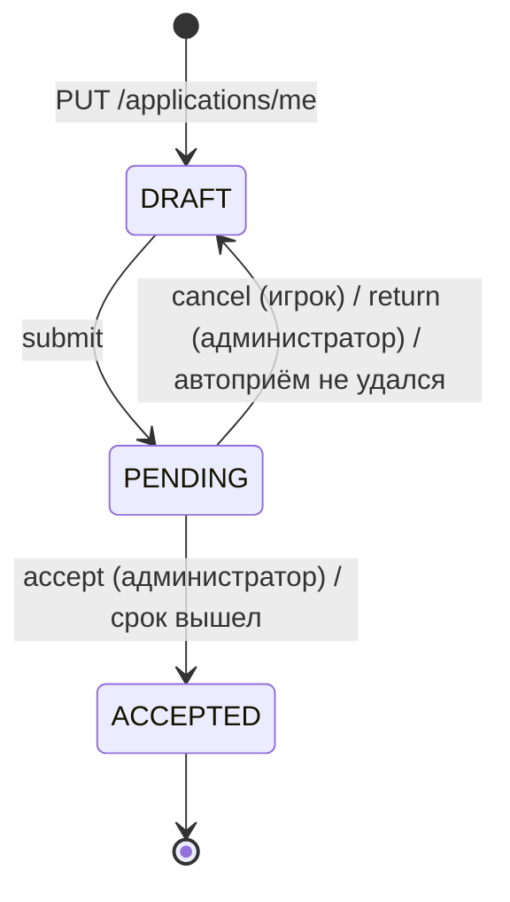

# 02_SYSTEM_SPECS / 00_core — Анкеты государств

> Контракт рассмотрения анкет (версия 0.13.0, решения Project Owner 19.10, 23.10 и 31.10.2026 — журнал `docs/04_VERSIONS/0.13.0.md`). Основной Spec — `docs/02_SYSTEM_SPECS/00_core.md`; здесь только то, что добавляет анкета. Слово «анкета» везде означает заявку на регистрацию государства; «ссылка на историю» остаётся ссылкой на историю. Государство в базе до принятия анкеты не создаётся; в Реестре анкеты нет.

## 1. Данные

`nation_applications` — владелец `00_core`; по строке на каждую анкету.

| Поле | Тип | Ограничения |
| --- | --- | --- |
| `id` | UUID | PK |
| `owner_player_id` | UUID | FK → `players.id`, NOT NULL |
| `status` | VARCHAR(10) | `DRAFT` / `PENDING` / `ACCEPTED` (CHECK), NOT NULL |
| профильные поля | как в `nations` | `name`, `short_name`, `color_hex`, `motto`, `description`, `leader_name`, `leader_title`, `gender`, `succession_type`, `leader_bio`, `history_url`, `capital_name`: те же типы и обязательность, что у государства |
| `capital_province_id` | INTEGER | FK → `provinces.id`, `ON DELETE SET NULL`, NULLABLE |
| `draft_reason` | VARCHAR(10) | NULL; у `DRAFT`: `returned` (вернул администратор), `cancelled` (отменил игрок), `failed` (автоприём не удался) |
| `return_comment` | VARCHAR(300) | NULL; причина возврата (длина из конфига) |
| `submissions` | INTEGER | число отправок, NOT NULL, default 0 |
| `submitted_at`, `review_deadline_at` | TIMESTAMPTZ | NULL вне `PENDING`; срок = отправка + `applications.review_hours` |
| `reviewer_player_id`, `reviewer_assigned_at` | UUID, TIMESTAMPTZ | FK → `players.id` `ON DELETE SET NULL`; кому ушло сообщение о рассмотрении |
| `decided_at`, `decided_by_player_id`, `auto_accepted` | TIMESTAMPTZ, UUID, BOOLEAN | заполняются при принятии; `decided_by_player_id` NULL при автоприёме |
| `accepted_nation_id` | UUID | FK → `nations.id`, `ON DELETE SET NULL` |
| `created_at`, `updated_at` | TIMESTAMPTZ | NOT NULL |

Частичные уникальные индексы: `owner_player_id` — где `status IN ('DRAFT','PENDING')` (одна живая анкета на игрока; принятая не мешает новой после удаления государства); `name`, `short_name`, `color_hex` — каждый где `status = 'PENDING'`.

`nation_application_provinces`: `application_id` FK → `nation_applications.id` `ON DELETE CASCADE`; `province_id` FK → `provinces.id`; `position` INTEGER (порядок выбора); `is_reserved` BOOLEAN NOT NULL; PK `(application_id, province_id)`; частичный уникальный индекс `province_id` где `is_reserved`. Флаг `is_reserved` ведёт только сервис анкет: истина ровно у строк анкеты в `PENDING`.

`nation_images` (миграция 0019): `nation_id` становится NULLABLE, добавляется `application_id` UUID FK → `nation_applications.id` `ON DELETE CASCADE`; CHECK «заполнено ровно одно из двух»; `UNIQUE (application_id, kind)`. При принятии строки картинок переписываются на государство. Картинка черновика или анкеты в рассмотрении лежит по тому же адресу по содержимому и так же публична, как картинки государств; адрес знает только тот, кому его отдал сервер.

Классификация таблиц в тесте «забытая таблица»: обе таблицы анкет — `reset`; сброс мира и хук удаления игрока удаляют анкеты и их картинки явным `delete`.

## 2. Состояния

- `DRAFT` ничего не резервирует. Править черновик, загружать картинки и отправлять его можно только в `DRAFT`; в `PENDING` игрок анкету править не может, только отменить (решение 31.10.2026).
- `PENDING` резервирует провинции, цвет, полное и краткое название (разд. 3).
- Принятая анкета остаётся строкой-снимком (`ACCEPTED`) и хранит историю выбора рецензента.
- У игрока не больше одной живой анкеты (индекс) и либо анкета, либо государство: `PUT /applications/me` при существующем государстве отвечает 409 `NATION_ALREADY_EXISTS`.

## 3. Инварианты

- **APP-1 (резерв):** пока анкета в `PENDING`, её провинции, цвет, полное и краткое название заняты для всех: для `NationService.create` (в том числе из панели), для передачи провинций администратором, для проверки цвета, для выбора на карте, для других анкет. Цвет анкеты в `PENDING` участвует в расчёте различимости как цвет государства. Собственный резерв анкеты не мешает ей самой при принятии.
- **APP-2 (атомарность):** отправка, отмена, возврат и принятие — каждое одна транзакция под `NATIONS_ADVISORY_LOCK_KEY` (тот же ключ, что у государств). Принятие создаёт государство теми же записями, что `NationService.create` (INV-3, `notify_ownership_changed` по каждой провинции, проверки сателлитов `after_free`/`after_count`), но без хука бота `nation_created`: вместо него событие `ACCEPTED`.
- **APP-3 (решает один):** решение принимает любой администратор, кроме заявителя; решение возможно только из `PENDING` (иначе 409 `APPLICATION_NOT_PENDING`, `detail` называет текущее состояние: отозвана, принята, возвращена). Решение, отмена и автоприём состязаются за строку; побеждает первый, остальные получают 409.
- **APP-4 (молчание):** по истечении `review_deadline_at` анкета принимается «как есть» фоновой задачей; запись журнала `application.auto_accept` с `actor_vk_user_id = 0` («Система»). Если автоприём не удался (на проверке выяснилось нарушение), анкета становится `DRAFT` с `draft_reason = failed` и системным комментарием, игроку уходит событие `RETURNED`. Администраторов нет или заявитель единственный — анкета ждёт срока и принимается сама.
- **APP-5 (игрок без государства):** пока анкета в `PENDING`, «Штаб» игроку недоступен: приложение открывает окно его анкеты; карта и Реестр доступны, анкеты в Реестре нет.
- **APP-6 (анонимность резерва):** другим игрокам видны только группы провинций без имени игрока, названий и цвета анкеты.
- **APP-7:** комментарий возврата обязателен, 1…`applications.comment_max_length` символов после нормализации (INV-17); ошибка — 422 `RETURN_COMMENT_INVALID`.

## 4. Порядок операций

**Сохранение черновика** (`PUT /applications/me`, тело — те же поля, что `NationCreateRequest`): игрок без государства → состояние `DRAFT` или анкеты нет (иначе 409 `APPLICATION_NOT_EDITABLE`) → проверки формата и длин всех профильных полей в порядке создания государства (INV-9) → запись. Занятость названий, цвета и провинций здесь не проверяется.

**Отправка** (`POST /applications/me/submit`): `DRAFT` → блокировка → повторные проверки формата → названия и краткое название против государств и других `PENDING` (`NAME_TAKEN`, `SHORT_NAME_TAKEN`) → цвет (`COLOR_TAKEN`, `COLOR_TOO_CLOSE`: против государств, цветов карты и цветов других `PENDING`) → провинции: существуют, свободны и не зарезервированы (`PROVINCE_TAKEN`), `after_free`, число, `after_count`, столица → `PENDING`, `is_reserved = true`, `submitted_at`, `review_deadline_at`, `submissions + 1`, очистка `draft_reason` и `return_comment`, выбор рецензента (разд. 5) → событие `SUBMITTED`.

**Отмена** (`POST /applications/me/cancel`): `PENDING` → `DRAFT`, `draft_reason = cancelled`, резерв снят, срок обнулён, событие `CANCELLED`.

**Возврат** (`POST /admin/applications/{id}/return`): `PENDING` → `DRAFT`, `draft_reason = returned`, `return_comment`, резерв снят, событие `RETURNED`, журнал `application.return`.

**Принятие** (`POST /admin/applications/{id}/accept`): проверки как при отправке, кроме собственного резерва → создание государства → картинки переписаны на государство → `ACCEPTED`, резерв снят → событие `ACCEPTED` → журнал `application.accept`.

**Удаление картинки администратором** (`POST /admin/applications/{id}/images/{kind}/delete`, по образцу удаления у государства, предпросмотр и подтверждение в окне): работает в `PENDING` и `DRAFT`, анкета остаётся в своём состоянии; журнал `application.image_delete`.

## 5. Выбор рецензента

Чистая функция без обращений к базе, точка подмены в тестах (по образцу `select_judge_v1` модуля `04_orders`). Кандидаты — администраторы (`.env` и гранты), у которых есть строка `players`, кроме заявителя. Победитель минимизирует `(число анкет в PENDING на нём, reviewer_assigned_at последней его анкеты — отсутствие считается самым давним, player_id)`. Нет кандидатов — `reviewer_player_id = NULL`; фоновая задача пробует назначить, пока анкета в `PENDING`. Рецензент определяет только, кому уйдёт сообщение бота и чья анкета помечена «назначена мне»; решить может любой администратор (APP-3). Переназначения нет.

## 6. Фоновая задача

Одна задача на процесс (по образцу `OrdersWorker`), запускается в `lifespan`, период `applications.worker_interval_seconds`. Проход: (а) анкеты `PENDING` со сроком в прошлом — автоприём, каждая в своей транзакции, сбой одной не останавливает остальные; (б) анкеты `PENDING` без рецензента — попытка назначения. Осознанное исключение из Tick DAG: сроки идут по реальному времени, фазы тика не затрагиваются. Режим и момент последнего прохода — плитка «Анкеты» в состоянии мира панели; просроченные после простоя сервера принимаются при первом проходе.

## 7. События и хуки

- **Реестр слушателей анкет** (`hooks.py`, по образцу `nation_created`): `register_application_listener(name, fn)`; событие `ApplicationEvent(kind, application_id, owner_player_id, reviewer_player_id, comment, auto)`, `kind` ∈ `SUBMITTED` / `CANCELLED` / `RETURNED` / `ACCEPTED`. Слушатель вызывается в транзакции операции под своим SAVEPOINT; его ошибка логируется и решения не отменяет (в отличие от слушателей смены владельца). Снимок и восстановление для тестов — как у остальных реестров.
- **Бот (`02_bot`, Issue 8):** игроку — `SUBMITTED` (анкета получена, срок), `RETURNED` (с причиной), `ACCEPTED` (в том числе автоматически, с пометкой), с ссылкой на окно анкеты `#application`; рецензенту — `SUBMITTED` со ссылкой `#application/<id>`; `CANCELLED` сообщений не создаёт. Тип сообщения и отсутствие согласия — по правилам Spec `02_bot` (уведомление без согласия не уходит, это закрывают щит и панель).
- **«Требует внимания»:** `AdminRegistry.register_attention(module_slug, fn)`, `fn(session)` возвращает список `{"key", "label", "count"}`; `GET /api/v1/admin/attention` (`require_admin`) отвечает `{total, items}`, падающий хук логируется и пропускается. `00_core` отдаёт «Анкеты на рассмотрении» (число `PENDING`), `04_orders` — «Приказы без судьи». Щит подсвечивается при `total > 0`.
- **Публичные представления для сателлитов:** `ApplicationService.reserved_groups(session)` — список групп `[province_id, ...]`, по группе на анкету в `PENDING`, без идентификаторов и без игрока; `ApplicationService.reserved_colors(session)` — цвета анкет в `PENDING` для расчёта различимости.

## 8. Сеть

| Метод | Путь | Кто | Ответ |
| --- | --- | --- | --- |
| GET | `/api/v1/applications/me` | Bearer | `ApplicationDTO` / 404 |
| PUT | `/api/v1/applications/me` | Bearer | `ApplicationDTO` |
| PUT | `/api/v1/applications/me/images/{kind}` | Bearer | `NationImageDTO` (только `DRAFT`) |
| POST | `/api/v1/applications/me/submit` | Bearer | `ApplicationDTO` |
| POST | `/api/v1/applications/me/cancel` | Bearer | `ApplicationDTO` |
| GET | `/api/v1/admin/applications` | админ | `{items, total}`: `status` = `PENDING` (по умолчанию) или `ALL`, `limit`, `offset` |
| GET | `/api/v1/admin/applications/{id}` | админ | `AdminApplicationDTO` |
| POST | `/api/v1/admin/applications/{id}/accept` | админ | `AdminApplicationDTO` |
| POST | `/api/v1/admin/applications/{id}/return` | админ | тело `{comment}` |
| POST | `/api/v1/admin/applications/{id}/images/{kind}/delete` | админ | `AdminApplicationDTO` |
| GET | `/api/v1/admin/attention` | админ | `{total, items}` |

`ApplicationDTO`: профильные поля, `status`, `draft_reason`, `return_comment`, `review_deadline_at`, `submissions`, `provinces` (названиями, столичная первая), `images` (адреса через `images.image_url`). `AdminApplicationDTO` добавляет `id`, `owner_vk_user_id`, `owner_name`, `assigned_to_me`, `submitted_at`, `decided_at`, `auto_accepted`. Строка списка: `id`, `short_name`, `name`, `status`, `submitted_at`, `review_deadline_at`, `assigned_to_me`, `submissions`. `GET /nations/rules` получает `application`: `review_hours`, `comment_max_length`.

Новые коды: `APPLICATION_NOT_FOUND` 404, `APPLICATION_NOT_EDITABLE` 409, `APPLICATION_NOT_PENDING` 409, `APPLICATION_SELF_REVIEW` 403, `RETURN_COMMENT_INVALID` 422, `PROVINCE_RESERVED` 409 (передача провинции администратором в резерв). Названия, цвет и провинции, занятые анкетой, для остальных путей отвечают прежними кодами `NAME_TAKEN`, `SHORT_NAME_TAKEN`, `COLOR_TAKEN`, `COLOR_TOO_CLOSE`, `PROVINCE_TAKEN`.

## 9. Конфиг `applications`

| Ключ | Тип | min | max | значение |
| --- | --- | --- | --- | --- |
| `applications.review_hours` | int, часы | 1 | 168 | **24** |
| `applications.comment_max_length` | int, символы | 10 | 1000 | **300** |
| `applications.worker_interval_seconds` | int, секунды | 10 | 600 | **60** |

Ключи обязательны; схема — раздел `applications` в `config_schema.py`; тест `test_configs_validity.py` проверяет `comment_max_length` против длины колонки `return_comment` (300 и более в колонке).

## 10. Окна и адреса

Вид — по макетам версии 0.13.0 (папка docs/06_DESIGN/0.13.0, единица 3), правила — `docs/02_SYSTEM_SPECS/00_core_ui.md`.

- **Регистрация:** четыре вкладки не меняются; последняя кнопка называется «Отправить анкету». Она по очереди сохраняет черновик, загружает выбранные картинки и отправляет анкету; сбой на любом шаге оставляет черновик, показывает ошибку у своей вкладки и повторяется той же кнопкой. Отдельного окна отправки нет.
- **Черновик после возврата или отмены:** то же окно регистрации, заполненное из черновика; над вкладками плашка с причиной возврата или словом «отменена вами».
- **Окно анкеты, вид игрока** (`#application`): анкета целиком без возможности правки, статус «на рассмотрении», срок решения, кнопка «Отменить». Открывается вместо «Штаба», пока анкета в `PENDING`.
- **Окно анкеты, вид администратора** (`#application/<id>`): та же анкета, картинки с «Удалить», кнопки «Принять» и «Вернуть» (причина в поле до 300 символов); для отозванной, принятой или возвращённой анкеты кнопки решения скрыты и показано состояние. Открывается по ссылке бота и из подраздела «Анкеты» панели.
- **Щит:** слегка подсвечен при `GET /admin/attention`: `total > 0`; опрос раз в минуту, пока открыт «Штаб», и при возврате фокуса.
- **Панель:** раздел «Государства» получает подраздел «Анкеты» — список (по умолчанию `PENDING`, переключатель «Все»), строка — ссылка на окно анкеты; плитка состояния «Анкеты».

## 11. Остальные модули

- **`01_map`:** `GET /map/state` отдаёт `reservations` — список групп провинций из `reserved_groups`; клиент обводит каждую группу жёлтым пунктиром по внешней границе как границу государства, провинции группы постоянно светятся белым, при наведении подсказка «Территория зарезервирована игроком, подавшим анкету»; `GET /provinces?free_only=` и выбор на карте не считают зарезервированные провинции свободными. Штриховки нет.
- **`03_registry`:** анкеты в Реестре не показываются совсем; код не меняется.
- **`04_orders`:** хук «Приказы без судьи» для щита; приказы анкет не касаются.
- **Панель:** передача провинции и создание государства администратором уважают резерв (APP-1); сброс мира и удаление игрока убирают анкеты.
