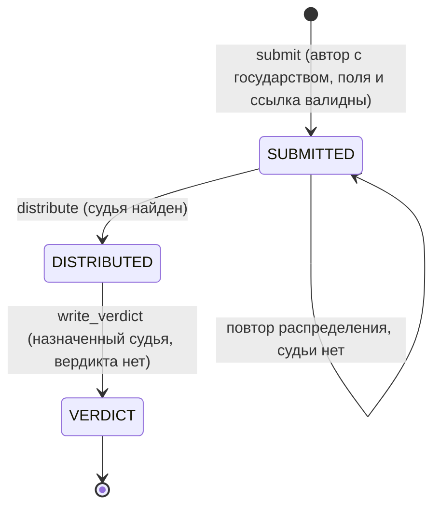

# 02_SYSTEM_SPECS / 04_orders

> Версия Spec: 1.2 (16.10.2026). Изменение 1.0 → 1.1: добавлен предел неразрешённых приказов на одного автора (D14, INV-O15, `author.max_unresolved_orders = 5`, код `ORDER_AUTHOR_LIMIT_REACHED`). Вход: `docs/01_GAME_BIBLE/04_orders.md` (утверждена Project Owner 15.10.2026).
>
> **Изменения 1.1 → 1.2** (приведение к факту после реализации, Issue 10):
>
> - `submit` возвращает `SubmitOutcome` (представление + признак `created`), `write_verdict` — `OrderDetailView`; в публичный API добавлен `unresolved_count`; описаны поля представлений и `RetryPassStats` (2.5).
> - Фоновая задача запускается в `lifespan` отдельной функцией `start_orders_worker_if_ready()` после `startup_orders()` (2.3, D11); паузы цикла при ошибках — 5, 15, 60 с (INV-O8).
> - Захват строки напоминания требует также `verdict_at IS NULL`: вердикт, записанный между чтением кандидатов прохода и захватом, отменяет напоминание (2.3, INV-O1).
> - Проход напоминаний берёт до `batch_size` приказов, старые `reminder_at` первыми (2.3).
> - Хук состояния отдаёт ключи по факту, включая `overdue_truncated` (5.7).
> - Список файлов клиента приведён к реальному расположению: конструкторы и окна — в корне модуля, `components/` содержит `OrdersBlock.tsx` и `NationMark.tsx` (5.4).
> - Ответы ошибок при наличии уточнений несут поле `details` (5.3); порядок проверок вердикта дополнен шагом модульной блокировки и фиксацией условного `UPDATE` (5.1).
> Артефакты шага: этот файл, `configs/04_orders.yaml`, `backend/src/modules/_04_orders/config_schema.py`.
> Зависимости: `00_core`, `02_bot`, `03_registry`. `01_map` не требуется.
> Релиз модуля: 0.7.0 (вместе с Реестром); Spec действует в версии 0.10.0.

---

## 0. Принятые архитектурные решения

**D1. Одна таблица `orders`.** Вердикт — колонки приказа, а не отдельная таблица: у приказа не больше одного вердикта, запись и чтение идут одной строкой, запись вердикта — один условный `UPDATE`. Стадия приказа не хранится, а выводится из заполненности колонок (D4).

**D2. Номер приказа хранится.** Порядковый номер — публичный идентификатор приказа (в таблице Реестра, в ссылке `#registry/order-N`, в уведомлениях бота). Он назначается при подаче как следующий за наибольшим (с повтором при коллизии уникального ключа) и не меняется. После сброса мира нумерация начинается с 1. Номер, а не UUID, виден клиенту.

**D3. Фоновые задачи вне Tick DAG.** Модуль не регистрирует обработчиков в `TickPhase`. Сроки считаются в реальных часах; повтор распределения и напоминания судьям идут фоновой задачей процесса сервера по образцу `02_bot` и `03_registry`. Это осознанное исключение из инварианта «расчёт — в одной из пяти фаз»: приказы не считают игровое состояние хода (Часть 2.4).

**D4. Стадия — производная.** `SUBMITTED` (нет судьи), `DISTRIBUTED` (судья есть, вердикта нет), `VERDICT` (вердикт есть). Согласованность колонок закреплена `CHECK`-ограничениями БД, а не только сервисом.

**D5. Срок и напоминание фиксируются в строке.** В момент назначения в приказ записываются `deadline_at` и `reminder_at` (по конфигу на тот момент). Правка конфига не меняет уже назначенные приказы.

**D6. Анонимность судьи на уровне контракта API.** Ни один DTO игрока не содержит поля судьи. Признак `can_write_verdict` вычисляется сервером для конкретного зрителя. Судью видит только админ-хук (Часть 5.7).

**D7. Общая проверка ссылки на статью ВК.** В `00_core/profile_rules.py` выделяется общая функция `validate_vk_article_url(value, *, max_length, allowed_hosts)`; `validate_history_url` становится её обёрткой (поведение не меняется). Модуль приказов вызывает общую функцию со своим пределом длины и теми же хостами, что `nation.history_url_allowed_hosts`: правило «те же домены» обеспечено без дублирования списка. Известное ограничение то же, что у `history_url`: формат проверяется, содержимое — нет; ссылка вида `/@имя` страницы автора формат проходит.

**D8. Достижимость судьи через публичный API бота.** Для проверки согласия модуль использует новую публичную функцию `BotService.consented_player_ids`, а не таблицы бота. Если бот выключен, согласий нет: игроки без государства не достижимы, владельцы государств достижимы всегда.

**D9. Уведомления: номер вместо названия, ссылка как специальная переменная.** Четыре типа уведомлений (Приложение C). Переменные содержат номер и государство-автора, но не названия и суть, написанные игроками. Ссылка на окно приказа передаётся переменной `order_link`; её собирает бот (`BotService.app_link`), а переменные с суффиксом `_link` бот проверяет как ссылки, а не очищает как текст.

**D10. Тип уведомления без требования государства.** В `types.<КЛЮЧ>` бота вводится обязательный ключ `requires_nation`. У пяти встроенных типов он `true` (поведение не меняется), у четырёх типов приказов — `false`: судья без государства получает сообщение при наличии согласия.

**D11. Ранняя регистрация расширений.** Источник таблицы Реестра и типы уведомлений регистрируются функцией `register_orders_extensions()` в `lifespan` строго раньше `startup_registry()` и `startup_bot()` (оба проверяют реестры против конфигов при старте). Загрузка конфига модуля — `startup_orders()` после всех остальных `startup_*`; запуск и остановка фоновой задачи — `start_orders_worker_if_ready()` и `OrdersWorker.stop()` в `lifespan` следом за ней (2.3).

**D12. Блок «Приказы» только в штабе.** По решению G (15.10.2026) на экране регистрации государства блока нет. Судья без государства работает через уведомление бота и окно приказа в Реестре.

**D13. Ответственность за расширения Реестра.** Столбец-иконка, ячейки «дата и время» и «название-действие», флаг у названия государства, вход по хэшу `#registry/order-N` — расширения `03_registry`; контракты — Приложение A, правки — Приложение B (B3). Реестр не знает про приказы: действия по клику регистрируются клиентским модулем приказов.

**D14. Предел неразрешённых приказов на автора (решение Project Owner, 15.10.2026).** Автор не может иметь одновременно больше `author.max_unresolved_orders` (старт 5) приказов без вердикта. «Неразрешённый» — любой приказ автора, у которого нет вердикта: и ожидающий судью, и распределённый, и просроченный. Вердикт освобождает место. Цель — не дать одному игроку занять всех судей и забить очередь. Проверка и вставка выполняются под той же модульной блокировкой, что и распределение (на PostgreSQL), поэтому два одновременных запроса одного автора не обходят предел; блокировка повторно входимая в пределах транзакции, попытка распределения внутри подачи берёт её без ожидания. Известное ограничение версии 1: если судья не отвечает, место автора занято, пока вердикт не будет записан; администратор видит такие приказы в хуке состояния (5.7) и может временно поднять предел в конфиге. Переназначение судьи администратором — в бэклоге.

**Параметры, которые подтверждает Project Owner при утверждении Spec** (стартовые значения предложены Lead, живут в конфиге):

- срок на вердикт — 72 часа;
- напоминание судье — когда прошло 75 % срока;
- длина названия — 3…100 символов, краткой сути — 10…500, ссылки — до 200;
- предел ожидающих вердикта приказов у судьи — 5 (решено ранее), порог рейтинга — 0 (решено ранее);
- предел неразрешённых приказов на одного автора — 5 (решено Project Owner 15.10.2026).

---

## ЧАСТЬ 1: ДОМЕННАЯ МОДЕЛЬ

Идентификаторы — `String(36)` (UUID в строке), как в `00_core`. Все моменты времени — `TIMESTAMPTZ`. Внешние ключи — только на `players.id`.

### `orders`

| Поле | Тип | Ограничения |
| :-- | :-- | :-- |
| `id` | String(36) | PK, default `uuid4()` |
| `number` | Integer | UNIQUE, NOT NULL, ≥ 1; публичный номер (D2) |
| `author_player_id` | String(36) | FK → `players.id`, NOT NULL, индекс |
| `client_request_id` | String(36) | NOT NULL; UNIQUE (`author_player_id`, `client_request_id`) — идемпотентность подачи |
| `nation_id` | String(36) | NOT NULL; **без FK**: снимок на момент подачи |
| `nation_name` | String(100) | NOT NULL; снимок |
| `nation_color` | CHAR(7) | NOT NULL; снимок, формат `#RRGGBB` |
| `nation_short_name` | String(100) | NOT NULL; снимок краткого названия (миграция 0013) |
| `title` | String(200) | NOT NULL |
| `summary` | String(2000) | NOT NULL |
| `article_url` | String(2000) | NOT NULL |
| `submitted_at` | TIMESTAMPTZ | NOT NULL; стадия «Подача» |
| `judge_player_id` | String(36) | FK → `players.id`, NULL, индекс |
| `distributed_at` | TIMESTAMPTZ | NULL; стадия «Распределение» |
| `deadline_at` | TIMESTAMPTZ | NULL; срок вердикта (D5) |
| `reminder_at` | TIMESTAMPTZ | NULL; момент напоминания (D5) |
| `reminder_sent_at` | TIMESTAMPTZ | NULL; напоминание обработано |
| `verdict_title` | String(200) | NULL |
| `verdict_summary` | String(2000) | NULL |
| `verdict_url` | String(2000) | NULL |
| `verdict_effects` | JSON | NULL; **резерв** структурированных эффектов, в версии 1 всегда `NULL` |
| `verdict_at` | TIMESTAMPTZ | NULL; стадия «Вердикт» |

Длины колонок равны верхним границам схемы конфига (200 / 2000 / 2000); это проверяет тест.

Флаг государства в приказе берётся на момент показа: сервис приказов получает его у `00_core` через `NationService.image_refs` по `nation_id` (миниатюра загруженного флага); у удалённого государства и у государства без флага флага нет, клиент показывает заглушку (решение Project Owner 27.10.2026; прежнее правило «в приказах всегда каталожный флаг» отменено). `ORDER_*`-ответы и ячейки Реестра сохраняют поле `flag_url`. Колонка `orders.nation_flag_id` удалена миграцией 0017 (версия 0.12.0, `00_core`).

**Именованные `CHECK`-ограничения:**

- `ck_orders_number_positive`: `number >= 1`.
- `ck_orders_judge_not_author`: `judge_player_id IS NULL OR judge_player_id <> author_player_id`.
- `ck_orders_distribution_all_or_none`: `judge_player_id`, `distributed_at`, `deadline_at`, `reminder_at` либо все `NULL`, либо все заполнены.
- `ck_orders_distribution_order`: `deadline_at IS NULL OR (distributed_at < reminder_at AND reminder_at < deadline_at)`.
- `ck_orders_verdict_all_or_none`: `verdict_title`, `verdict_summary`, `verdict_url`, `verdict_at` либо все `NULL`, либо все заполнены.
- `ck_orders_verdict_needs_judge`: `verdict_at IS NULL OR judge_player_id IS NOT NULL`.
- `ck_orders_verdict_after_distribution`: `verdict_at IS NULL OR verdict_at >= distributed_at`.
- `ck_orders_reminder_needs_judge`: `reminder_sent_at IS NULL OR judge_player_id IS NOT NULL`.

**Индексы:**

- `ix_orders_pending_by_judge` — по `judge_player_id` частичный `WHERE verdict_at IS NULL` (нагрузка судьи);
- `ix_orders_unassigned` — по `submitted_at` частичный `WHERE judge_player_id IS NULL` (очередь на распределение);
- `ix_orders_reminders_due` — по `reminder_at` частичный `WHERE reminder_sent_at IS NULL AND verdict_at IS NULL`.

Частичные индексы объявляются и для PostgreSQL (`postgresql_where`), и для SQLite (`sqlite_where`).

**Миграция.** Одна новая, следующая за актуальной головой (`0010_04_orders.py` при текущей `0009`; номер сверяет Devin). Только добавление таблицы; существующие таблицы не меняются. Класс — NEEDS LEAD AI REVIEW. `alembic/env.py` импортирует `modules._04_orders.models`; защитный тест дрейфа моделей и миграций подключает новую модель.

**Производная стадия** (`OrderStage`, не колонка): `VERDICT`, если `verdict_at` задан; иначе `DISTRIBUTED`, если задан `judge_player_id`; иначе `SUBMITTED`. **Просрочка** (`overdue`): `verdict_at IS NULL AND deadline_at IS NOT NULL AND now > deadline_at`.

---

## ЧАСТЬ 2: ИНВАРИАНТЫ, FSM И МЕСТО В TICK DAG

### 2.1. Инварианты

- **INV-O1. Неизменяемость.** После вставки не меняются никогда: автор, снимок государства, `title`, `summary`, `article_url`, `submitted_at`, `number`. Назначение пишется один раз условным `UPDATE … WHERE judge_player_id IS NULL`; вердикт — один раз `UPDATE … WHERE judge_player_id = :judge AND verdict_at IS NULL`; `reminder_sent_at` — один раз `WHERE reminder_sent_at IS NULL AND verdict_at IS NULL` (вердикт, записанный между чтением кандидатов прохода и захватом строки, отменяет напоминание). Результат определяется по числу затронутых строк.
- **INV-O2. Стадии последовательны.** Обеспечивается `CHECK` (Часть 1); «перепрыгнуть» стадию, например записать вердикт без судьи, база не позволяет.
- **INV-O3. Судья не равен автору.** `CHECK` плюс исключение автора из кандидатов.
- **INV-O4. Предел нагрузки.** Число приказов судьи без вердикта не превышает `judge.max_pending_verdicts` в момент назначения. Выбор судьи и запись назначения выполняются под модульной блокировкой с пересчётом нагрузки внутри неё (3.3). Понижение предела в конфиге не отзывает назначенное.
- **INV-O5. Анонимность судьи.** Ни один эндпоинт игрока не возвращает идентификатор или профиль судьи. На запись вердикта не-судьёй сервер отвечает одним и тем же `ORDER_VERDICT_FORBIDDEN` независимо от того, есть ли у приказа судья и кто он.
- **INV-O6. Снимок государства.** Полное и краткое название и цвет государства-автора в приказе фиксируются при подаче и не обновляются при переименовании, смене краткого названия, цвета или удалении государства. Флаг в снимок не входит — он берётся на момент показа через `NationService.image_refs` модуля `00_core` (версия 0.12.0). Снимок заполняется из публичного представления `NationService.player_nation_summary` модуля `00_core` — модуль не читает таблицу `nations` напрямую (INV-O7).
- **INV-O7. Суверенность данных.** Внешние ключи — только на `players`. Игроки, рейтинг, государство, согласие бота — только через публичные функции модулей-владельцев. Чужие таблицы не изменяются. Уведомления — только `BotService.enqueue` в той же транзакции, результат не влияет на исход операции, исключений не бросает.
- **INV-O8. Изоляция сбоев.** Распределение каждого приказа выполняется под собственным `SAVEPOINT`: сбой распределения или постановки уведомления не отменяет подачу приказа и вердикта. Проход фоновой задачи по одному приказу не прерывает проход по остальным. Задача не умирает от исключения (цикл «шаг → при ошибке пауза 5 → 15 → 60 с → дальше», как в боте).
- **INV-O9. Идемпотентность подачи.** `UNIQUE (author_player_id, client_request_id)`: повтор с тем же идентификатором возвращает существующий приказ и ничего не создаёт.
- **INV-O10. Достижимость.** При `judge.require_reachable = true` кандидат — владелец государства либо игрок с согласием `ALLOWED` на сообщения бота.
- **INV-O11. Содержимое статей не трогается.** Сервер не открывает и не загружает ссылки игроков; хранит только строки, прошедшие проверку формата.
- **INV-O12. Время.** Все моменты хранятся в UTC с часовым поясом. Всё, что показывается игроку текстом (даты в Реестре и списке судьи), форматирует сервер в `tick.tick_timezone` из `00_core`.
- **INV-O13. Нет влияния на показатели.** `verdict_effects` в версии 1 всегда `NULL`: API не принимает это поле.
- **INV-O14. Сброс мира.** Хук сброса удаляет все приказы; игроки и рейтинг сохраняются; после сброса `number` снова начинается с 1.
- **INV-O15. Предел приказов на автора.** Число приказов автора без вердикта не превышает `author.max_unresolved_orders` в момент подачи. Подсчёт и вставка выполняются под модульной блокировкой (D14). Повтор запроса с тем же `client_request_id` предел не проверяет (возвращает существующий приказ). Понижение предела в конфиге не отзывает поданное.

### 2.2. Конечный автомат



Ортогональные признаки: `overdue` (срок вышел, вердикта нет) и `reminder_sent_at` (напоминание обработано). Обратных переходов нет.

### 2.3. Фоновая задача

Одна задача процесса сервера, запускается в `lifespan` вызовом `start_orders_worker_if_ready()` после `startup_orders()`, останавливается в завершении `lifespan` по образцу задач бота. Каждый проход (раз в `distribution.retry_interval_seconds`, а также по сигналу после подачи приказа и после вердикта):

1. **Повтор распределения.** До `distribution.batch_size` приказов без судьи в порядке `submitted_at, number`; для каждого — `distribute` под `SAVEPOINT` и собственной транзакцией; приказы разных авторов обрабатываются независимо (исключение автора меняет набор кандидатов).
2. **Напоминания.** До `distribution.batch_size` приказов с `reminder_at <= now`, `reminder_sent_at IS NULL`, без вердикта, старые `reminder_at` первыми. Строка захватывается условным `UPDATE … WHERE reminder_sent_at IS NULL AND verdict_at IS NULL` (0 строк — пропуск: отметку поставил другой проход или вердикт уже записан); если `now < deadline_at`, ставится уведомление судье и `reminder_sent_at = now`; если срок уже вышел (задача опоздала), напоминание не отправляется, `reminder_sent_at = now`, в журнал — INFO.

Один рабочий процесс — штатный режим. При нескольких процессах корректность сохраняется: назначение под модульной блокировкой, условные `UPDATE`, ключи дедупликации уведомлений.

### 2.4. Место в Tick DAG

**Регистрации в `TickPhase` нет.** `TickOrchestrator` о модуле не знает; смена хода приказы не затрагивает, приказы не читают игровое состояние хода. Исключение из инварианта 2 осознанное (D3).

### 2.5. Публичный API сервиса

```python
# backend/src/modules/_04_orders/service.py  (публичный API модуля)

class DistributeResult(str, Enum):
    ASSIGNED = "ASSIGNED"
    NO_CANDIDATES = "NO_CANDIDATES"      # приказ остаётся без судьи
    ALREADY_ASSIGNED = "ALREADY_ASSIGNED"

class OrderService:
    @staticmethod
    async def submit(session, *, player_id: str, client_request_id: str,
                     title: str, summary: str, article_url: str) -> SubmitOutcome: ...
    @staticmethod
    async def distribute(session, order_id: str, *, now: datetime | None = None) -> DistributeResult: ...
    @staticmethod
    async def run_retry_pass(session_factory, *, now: datetime | None = None) -> RetryPassStats: ...
    @staticmethod
    async def write_verdict(session, *, player_id: str, number: int,
                            title: str, summary: str, article_url: str) -> OrderDetailView: ...
    @staticmethod
    async def get_detail(session, *, number: int, viewer_player_id: str) -> OrderDetailView: ...
    @staticmethod
    async def list_assigned(session, *, player_id: str) -> list[AssignedOrderView]: ...
    @staticmethod
    async def list_for_registry(session) -> list[RegistryOrderView]: ...   # без полей судьи
    @staticmethod
    async def unresolved_count(session, *, player_id: str) -> int: ...     # приказов автора без вердикта (INV-O15)

# Представления сервиса — ни в одном нет полей судьи (INV-O5):
@dataclass(frozen=True)
class OrderDetailView:
    number: int
    nation_name: str
    nation_color: str
    nation_short_name: str
    nation_flag_sha256: str | None
    title: str
    summary: str
    article_url: str
    distributed: bool               # судья назначен
    verdict_title: str | None
    verdict_summary: str | None
    verdict_url: str | None
    overdue: bool
    can_write_verdict: bool         # истинно только для назначенного судьи без вердикта

@dataclass(frozen=True)
class SubmitOutcome:
    view: OrderDetailView
    created: bool                   # False — идемпотентный повтор (INV-O9)

@dataclass(frozen=True)
class AssignedOrderView:            # очередь судьи; deadline_at не NULL (INV-O4)
    number: int
    nation_name: str
    nation_color: str
    nation_short_name: str
    nation_flag_sha256: str | None
    title: str
    summary: str
    article_url: str
    deadline_at: datetime
    overdue: bool

@dataclass(frozen=True)
class RegistryOrderView:            # строка источника Реестра (Приложение A)
    number: int
    nation_name: str
    nation_color: str
    nation_short_name: str
    nation_flag_sha256: str | None
    title: str
    submitted_at: datetime
    distributed_at: datetime | None
    deadline_at: datetime | None    # для отметки просрочки
    verdict_at: datetime | None

@dataclass(frozen=True)
class RetryPassStats:               # счётчики одного прохода (2.3)
    assigned: int
    still_waiting: int
    reminders_sent: int
    reminders_skipped: int
    errors: int

# backend/src/modules/_04_orders/distribution.py
@dataclass(frozen=True)
class JudgeCandidate:
    player_id: str
    rating: int
    has_nation: bool
    consented: bool
    pending: int                       # приказов без вердикта
    last_assigned_at: datetime | None  # None — никогда не назначался

JudgeSelector = Callable[[str, Sequence[JudgeCandidate], JudgeSettings], str | None]
def select_judge_v1(author_player_id, candidates, settings) -> str | None: ...
```

`select_judge_v1` — чистая детерминированная функция (3.3), заменяемая без изменения остального кода: сервис получает селектор через единственную точку подстановки (`distribution.judge_selector`).

Правила проверки полей (`rules.py` модуля): `validate_title`, `validate_summary` — обрезка краевых пробелов, длины из `limits`; запрещены символы категорий управляющих (`Cc`, кроме перевода строки в краткой сути), форматирующих (`Cf`), суррогатов (`Cs`), частного использования (`Co`) и неназначенных (`Cn`); в названии переводы строки запрещены; в краткой сути переводы строки нормализуются к `\n`. `validate_article_url` — обёртка общей функции из D7. Пустое после обрезки значение — ошибка.

---

## ЧАСТЬ 3: МАТЕМАТИЧЕСКИЙ АППАРАТ

Формулы здесь простые и целочисленные; деления на ноль нет, округление вниз.

### 3.1. Нагрузка судьи и последнее назначение

$$P(j) = \#\{\, o : judge(o) = j \;\wedge\; verdict\_at(o) = \varnothing \,\}$$

$$\tau(j) = \max\{\, distributed\_at(o) : judge(o) = j \,\}, \qquad \tau(j) = -\infty \text{ при отсутствии назначений}$$

Оба значения считаются одним агрегирующим запросом по `judge_player_id IS NOT NULL` (сумма по условию для `P`, максимум для `τ`).

### 3.2. Допустимые судьи

Для приказа автора $a$:

$$E(a) = \{\, j : j \ne a \;\wedge\; r_j \ge r_{min} \;\wedge\; P(j) < M \;\wedge\; (\neg Q \;\vee\; has\_nation(j) \;\vee\; consented(j)) \,\}$$

где $r_j$ — судейский рейтинг, $r_{min}$ — `judge.min_rating`, $M$ — `judge.max_pending_verdicts`, $Q$ — `judge.require_reachable`.

### 3.3. Выбор судьи (алгоритм v1)

$$k(j) = \bigl(P(j),\; \tau(j),\; id_j\bigr), \qquad j^{*} = \arg\min_{j \in E(a)} k(j) \text{ (лексикографически)}$$

Игрок, которого никогда не назначали, имеет $\tau = -\infty$ и при равной нагрузке идёт первым. Идентификатор делает порядок полным: ничьей нет, выбор детерминирован. Если $E(a) = \varnothing$, результат `NO_CANDIDATES`.

**Порядок шагов `distribute` (одна транзакция):**

1. Получить модульную блокировку: для PostgreSQL `pg_advisory_xact_lock(<ключ модуля>)`; для SQLite блокировка не нужна (единственный писатель).
2. Перечитать приказ; если судья уже есть — `ALREADY_ASSIGNED`.
3. Игроки и рейтинг — `PlayerService.list_for_registry` (публичное чтение `00_core`, отдаёт идентификатор, рейтинг и государство).
4. Если $Q$: для игроков без государства получить `BotService.consented_player_ids`.
5. Один агрегирующий запрос по `orders` — $P$ и $\tau$.
6. Построить кандидатов и вызвать селектор.
7. Условный `UPDATE` назначения (INV-O1): судья и по конфигу на момент назначения `deadline_at`/`reminder_at` (D5). Проверить число затронутых строк.
8. Поставить два уведомления (`event_at = distributed_at`): судье `order_assigned:<id>`, автору `order_distributed:<id>`.

### 3.4. Срок и напоминание

$$D = t_d + 3600 \cdot H, \qquad R = t_d + \left\lfloor \frac{3600 \cdot H \cdot p}{100} \right\rfloor$$

где $t_d$ — момент назначения, $H$ — `verdict_deadline_hours`, $p$ — `reminder_percent`. Целочисленная арифметика даёт воспроизводимый результат. Схема гарантирует $t_d < R < D$ и запас между $R$ и $D$ не менее двух периодов фоновой задачи (Часть 4).

Часы в тексте напоминания считаются в момент отправки:

$$h = \max\!\left(1,\; \left\lceil \frac{D - t}{3600} \right\rceil\right)$$

### 3.5. Номер приказа

$$number = 1 + \max(0,\; \max_o\, number(o))$$

Вычисляется в той же транзакции, что и вставка. При нарушении `UNIQUE (number)` вставка повторяется (до 5 попыток под `SAVEPOINT`), затем ошибка `ORDER_NUMBER_CONFLICT` (500, в журнал ERROR). На объёмах игры коллизия возможна только при одновременной подаче.

---

## ЧАСТЬ 4: СПЕЦИФИКАЦИЯ КОНФИГУРАЦИИ

Файл `configs/04_orders.yaml`; схема `backend/src/modules/_04_orders/config_schema.py` (`OrdersConfig`). Все ключи обязательны; неизвестные ключи запрещены (`extra="forbid"`).

### 4.1. `judge`

| Ключ | Тип | Диапазон | Старт | Назначение |
| :-- | :-- | :-- | :-- | :-- |
| `min_rating` | целое | −100…100 | 0 | порог судейского рейтинга: судья имеет рейтинг не ниже порога |
| `max_pending_verdicts` | целое | 1…50 | 5 | предел приказов без вердикта у одного судьи |
| `require_reachable` | булево (строгое) | — | `true` | судья — только достижимый игрок (INV-O10) |
| `verdict_deadline_hours` | целое, ч | 1…720 | 72 | срок на вердикт |
| `reminder_percent` | целое, % | 10…95 | 75 | доля срока до напоминания |

Границы рейтинга −100…100 повторяют константы `JUDGE_RATING_MIN/MAX` из `00_core/player_stats.py`; совпадение проверяет тест.

### 4.2. `distribution`

| Ключ | Тип | Диапазон | Старт | Назначение |
| :-- | :-- | :-- | :-- | :-- |
| `retry_interval_seconds` | целое, с | 10…3600 | 60 | период прохода фоновой задачи |
| `batch_size` | целое | 1…500 | 50 | приказов без судьи за один проход |

### 4.3. `limits`

| Ключ | Тип | Диапазон | Старт | Назначение |
| :-- | :-- | :-- | :-- | :-- |
| `title_min_length` | целое | 1…20 | 3 | минимальная длина названия |
| `title_max_length` | целое | 1…200 | 100 | максимальная длина названия |
| `summary_min_length` | целое | 1…100 | 10 | минимальная длина краткой сути |
| `summary_max_length` | целое | 1…2000 | 500 | максимальная длина краткой сути |
| `url_max_length` | целое | 30…2000 | 200 | максимальная длина ссылки на статью |

Пределы общие для приказа и вердикта. Верхние границы не больше длин колонок.

### 4.4. `author`

| Ключ | Тип | Диапазон | Старт | Назначение |
| :-- | :-- | :-- | :-- | :-- |
| `max_unresolved_orders` | целое | 1…50 | 5 | предел приказов без вердикта у одного автора (D14, INV-O15) |

### 4.5. Перекрёстные правила схемы

- `title_min_length ≤ title_max_length`, `summary_min_length ≤ summary_max_length`.
- `2 · retry_interval_seconds ≤ deadline_seconds − reminder_seconds`: промежуток между напоминанием и концом срока вмещает не менее двух проходов, иначе «срок истекает через N ч» придёт после истечения срока.

Домены ссылок в конфиге не повторяются (D7). Тексты уведомлений — в `configs/02_bot.yaml` (Приложение C).

---

## ЧАСТЬ 5: СЕТЕВОЙ И UI КОНТРАКТ

Все эндпоинты под `/api/v1`, за общей зависимостью Bearer JWT (`get_current_player`); без токена — `401` по общим правилам. Ошибки домена — форма ядра `{"detail", "code"}`; исключения модуля наследуют `CoreDomainError`, коды добавляются в `_ERROR_CODE_STATUS` в `main.py`. Ответы `Cache-Control: no-store`. Номер приказа в пути — целое ≥ 1.

### 5.1. Эндпоинты

| Метод | Путь | Request DTO | Response DTO | Код |
| :-- | :-- | :-- | :-- | :-- |
| POST | `/orders` | `OrderCreateRequest` | `OrderDetailDTO` | 201 (новый) / 200 (повтор того же `client_request_id`) |
| GET | `/orders/rules` | — | `OrderRulesDTO` | 200 |
| GET | `/orders/assigned` | — | `AssignedOrdersDTO` | 200 |
| GET | `/orders/{number}` | — | `OrderDetailDTO` | 200 / 404 |
| POST | `/orders/{number}/verdict` | `VerdictCreateRequest` | `OrderDetailDTO` | 201 / 403 / 404 / 409 / 422 |

Таблица приказов в Реестре отдаётся штатным `GET /registry/tables/orders` (Приложение A).

Порядок проверок `POST /orders`: модульная блокировка (PostgreSQL) → повтор по `client_request_id` (вернуть существующий) → наличие государства → предел приказов автора (`ORDER_AUTHOR_LIMIT_REACHED`) → название → суть → ссылка → вставка с номером (повторы под `SAVEPOINT`, 3.5) → попытка распределения под `SAVEPOINT`.

Порядок проверок `POST /orders/{number}/verdict`: модульная блокировка (PostgreSQL) → существование приказа → игрок назначен судьёй (иначе `ORDER_VERDICT_FORBIDDEN`, в том числе когда судьи ещё нет) → вердикта ещё нет → название → суть → ссылка → условный `UPDATE` (INV-O1) → уведомление автору под `SAVEPOINT` (INV-O8).

### 5.2. DTO

```python
OrderCreateRequest  = { title: str, summary: str, article_url: str, client_request_id: UUID-строка }
VerdictCreateRequest = { title: str, summary: str, article_url: str }   # extra=forbid: поля effects нет (INV-O13)

OrderRulesDTO = { title_min_length: int, title_max_length: int,
                  summary_min_length: int, summary_max_length: int,
                  url_max_length: int,             # из limits конфига; клиент показывает счётчики
                  max_unresolved_orders: int,      # author.max_unresolved_orders
                  unresolved_orders: int }         # сколько приказов без вердикта у текущего игрока сейчас

NationMarkDTO = { name: str, color: str, short_name: str, flag_url: str | None }   # снимок государства-автора; flag_url — миниатюра загруженного флага на момент показа, строится только через images.image_url (INV-16), null — флага нет
VerdictDTO    = { title: str, summary: str, article_url: str }

OrderDetailDTO = {
  number: int,
  nation: NationMarkDTO,
  title: str, summary: str, article_url: str,
  distributed: bool,                 # стадия «Распределение» наступила
  verdict: VerdictDTO | None,
  overdue: bool,
  can_write_verdict: bool            # зритель — назначенный судья и вердикта нет
}

AssignedOrderDTO = {
  number: int, nation: NationMarkDTO,
  title: str, summary: str, article_url: str,
  deadline_text: str,                # «15.10.2026 21:21», по tick_timezone
  overdue: bool
}
AssignedOrdersDTO = { items: list[AssignedOrderDTO] }    # все приказы текущего игрока без вердикта
```

В DTO нет полей судьи, его идентификатора, профиля и ВК-идентификатора (INV-O5). `AssignedOrdersDTO` возвращает только приказы текущего игрока без вердикта, по возрастанию срока.

### 5.3. Коды ошибок

| Код | HTTP | Когда |
| :-- | :-- | :-- |
| `ORDER_NATION_REQUIRED` | 403 | у автора нет государства |
| `ORDER_AUTHOR_LIMIT_REACHED` | 409 | у автора уже `author.max_unresolved_orders` приказов без вердикта (D14) |
| `ORDER_TITLE_INVALID` | 422 | название не прошло проверку |
| `ORDER_SUMMARY_INVALID` | 422 | краткая суть не прошла проверку |
| `ORDER_URL_INVALID` | 422 | ссылка не прошла проверку формата/домена/длины |
| `ORDER_NOT_FOUND` | 404 | приказа с таким номером нет |
| `ORDER_VERDICT_FORBIDDEN` | 403 | игрок не назначен судьёй (одинаково для всех причин, INV-O5) |
| `ORDER_VERDICT_EXISTS` | 409 | вердикт уже записан |
| `ORDER_NUMBER_CONFLICT` | 500 | не удалось назначить номер (3.5) |

`message` — по-русски, с причиной (например «Ссылка должна вести на статью ВК вида vk.com/@…»). При наличии уточнений ответ содержит поле `details`: `ORDER_AUTHOR_LIMIT_REACHED` → `{"max_unresolved_orders": N}`, `ORDER_NOT_FOUND` и `ORDER_VERDICT_EXISTS` → `{"number": N}`. Ошибки полей клиент показывает у соответствующего поля по коду.

### 5.4. Клиент (VKUI, только desktop)

**Файлы** (`frontend/src/modules/04_orders/`): `api.ts`, `types.ts`, `texts.ts`, `hooks/useAssignedOrders.ts`, `hooks/useOrderDetail.ts`, `hooks/useOrderRules.ts`, `OrdersUiProvider.tsx` (контекст и хост окон), `registryFilters.ts` (регистрация фильтра «Назначены мне» в таблице Реестра — 5.6), `OrderComposer.tsx`, `ConfirmSubmitModal.tsx`, `OrderDetailModal.tsx`, `VerdictComposer.tsx`, `components/OrdersBlock.tsx`, `components/NationMark.tsx` (цветная метка и название государства-автора). Все окна не шире 910 px, без горизонтальной прокрутки; текст не ломается посреди слова.

**Интеграция.** `OrdersUiProvider` монтируется один раз в `AppShell` и хостит модальные окна модуля; он же регистрирует в Реестре обработчик действия `order` (5.6). `OrdersBlock` вставляется в `PanelNationHome`; в `PanelCreateNation` блока нет (D12).

**Мини-блок «Приказы» (штаб).** Заголовок «Приказы». Кнопка «Подать приказ» открывает конструктор. Ниже два значка-кнопки (версия 0.10.0, единица 7b): «Мои приказы» — число поданных игроком приказов без вердикта (`unresolved_orders` из `GET /orders/rules` — тот же маршрут, что читает конструктор) и «Приказы других игроков» — число приказов, назначенных игроку на суд (`GET /orders/assigned`; маршрут без разбивки на страницы, отдаёт всю очередь — число есть длина списка). Ноль — без кружка; 100 и больше — «99+»; неудачная загрузка — значок без числа, без окна ошибки. Щелчок по значку открывает вкладку «Приказы» Реестра с предустановкой фильтра (Spec `03_registry`, вход с предустановкой): «Мои приказы» — список «Государство» = краткое название государства игрока, «Приказы других игроков» — «Назначены мне» = «Да». Числа обновляются при показе блока и после подачи приказа или записи/отказа вердикта (общий сигнал обновления `OrdersUiProvider`); опроса нет. Списка «Ожидают вердикт» в «Штабе» нет: путь судьи к вердикту — значок → вкладка «Приказы» → строка → окно приказа → «Написать вердикт».

**Конструктор приказа (`OrderComposer`).** Три поля: название, краткая суть (многострочное), ссылка на статью ВК; пределы длины клиент получает из `GET /orders/rules` и показывает счётчиком у каждого поля; источник истины — сервер. Кнопка «Отправить приказ» ведёт в `ConfirmSubmitModal`: предупреждение «Уверены ли вы, всё ли проверили: изменить приказ после подачи нельзя», введённые значения целиком, кнопка «Открыть ссылку» (обычная ссылка `target="_blank" rel="noopener noreferrer"`), кнопки «Вернуться к правке» и «Да, отправить». `client_request_id` создаётся при открытии конструктора и сохраняется до успешной отправки или закрытия окна: повторное нажатие создаёт не более одного приказа. Над полями строка «Неразрешённых приказов: N из M» (из `GET /orders/rules`); при `N ≥ M` кнопка «Отправить приказ» неактивна, а рядом пояснение «Достигнут предел: дождитесь вердикта по одному из ваших приказов». Ошибки полей показываются у поля; `ORDER_NATION_REQUIRED` и `ORDER_AUTHOR_LIMIT_REACHED` — сообщением в окне (при втором клиент обновляет счётчик). После успеха окно закрывается, показывается уведомление «Приказ №N подан». Несохранённые данные при закрытии теряются.

**Окно сведений (`OrderDetailModal`).** Заголовок «Приказ №N» с цветной меткой и названием государства-автора. Блоки: название, «Краткая суть приказа», ссылка «Статья приказа»; при наличии вердикта — «Вердикт», название, «Краткая суть вердикта», ссылка «Статья вердикта». При `overdue` — отметка «Срок вердикта вышел». При `can_write_verdict` — кнопка «Написать вердикт». Судья нигде не показывается.

**Конструктор вердикта (`VerdictComposer`).** Три поля, как у приказа; ниже неактивный блок «Изменение показателей и модификаторы» с пояснением «Раздел станет доступен позже»; то же окно предупреждения о неизменяемости («…изменить вердикт после отправки нельзя»). `409 ORDER_VERDICT_EXISTS` и `403 ORDER_VERDICT_FORBIDDEN` — сообщение и обновление окна сведений.

### 5.5. Вход по ссылке `#registry/order-N`

`normalizeEntryHash` в `AppShell` распознаёт `#registry/order-<цифры>` (до 9 цифр; иначе значение игнорируется) и после успешной авторизации открывает панель Реестра на вкладке «Приказы» с запросом открыть окно сведений приказа N. Хэш лишь подсказка стартового экрана, не несёт данных и не даёт доступа к закрытому: окно сведений загружается обычным запросом под авторизацией игрока. Если приказа нет — сообщение «Приказ не найден».

### 5.6. Расширения Реестра (клиент и сервер)

Подробный контракт — Приложение A, список правок — Приложение B (B3). Кратко: столбец может иметь иконку вместо текста заголовка (`header_icon`, текст `title` остаётся подсказкой и подписью для доступности); новые типы ячеек `datetime` (дата и время в две строки) и `action_text` (кликабельный текст, действие `<обработчик>:<ссылка>`); у ячейки `nation` необязательный `flag_url` (в таблице приказов — миниатюра загруженного флага автора на момент показа; при его отсутствии `null` и показывается цветная метка государства); клиентская точка `registerCellAction(handler, fn)`, которой пользуется `OrdersUiProvider`.

**Фильтр «Назначены мне» (версия 0.10.0).** `OrdersUiProvider` регистрирует в таблице `orders` фильтр расширения Реестра `registerTableFilterExtension('orders', {id: 'assigned_to_me', label: 'Назначены мне', load})` (механизм — Spec 03_registry 5.5 «Фильтры расширений»): `load` читает `GET /orders/assigned` — очередь вердиктов самого вызывающего — и возвращает номера её приказов. Позиция «Да» оставляет строки `o<N>`, чьи номера входят в множество. Запрос строк таблицы не меняется и одинаков для всех игроков (INV-R10); судья никуда не передаётся и не раскрывается — фильтр целиком вычисляется в браузере из данных, которые вызывающий уже имеет (INV-O5). Этот же фильтр открывается предустановкой входа `preset: {assignedToMe: true}` (Spec 03_registry 5.5 «Вход с предустановкой»).

### 5.7. Админ-панель (`AdminRegistry`)

- `register_state_view("04_orders", fn)` возвращает ключи: `orders_total`, `stages` (`{"SUBMITTED", "DISTRIBUTED", "VERDICT"}`), `overdue_total`, `unassigned_total`, `oldest_unassigned_age_minutes`, `worker_mode` (`RUNNING`/`STOPPED`), `last_pass_at` (момент последнего прохода в памяти процесса), `overdue_orders` — список `[{number, judge_vk_user_id, deadline_at}]` (до 50; **только здесь** судья виден, эндпоинты админа — только для администратора), `overdue_truncated`, `assigned_orders` — список `[{number, author_vk_user_id, judge_vk_user_id, judge_nation_name, distributed_at, deadline_at, overdue}]` всех приказов с судьёй без вердикта, новые номера первыми, до 50 (`judge_nation_name` = `null`, если у судьи нет государства), `assigned_truncated` (`true`, если таких приказов больше 50). Игроки и государства читаются только через публичные функции `PlayerService`/`NationService` модуля 00_core (INV-O7). Время — строками `YYYY-MM-DD HH:MM:SS` в `tick.tick_timezone` через `format_game_time`. **INV-O5 ослаблен только для этого админ-представления:** ни один игровой эндпоинт или DTO не получает полей судьи — личность судьи не покидает админ-контур.
- `register_reset("04_orders", fn)` удаляет все приказы (INV-O14). Хуки сброса вызываются в порядке, обратном регистрации, до `00_core`.
- **Удаление игрока** (`register_player_delete_hook("04_orders.player_delete", fn)`): выполняется под той же модульной advisory-блокировкой, что и подача/распределение/вердикт (`pg_advisory_xact_lock` на PostgreSQL; на SQLite — без операции). Три шага: (i) приказы, где игрок — судья и вердикта нет, возвращаются в очередь ожидания — `judge_player_id`, `distributed_at`, `deadline_at`, `reminder_at`, `reminder_sent_at` обнуляются разом (все 8 CHECK сохраняются), автор сохраняет живой приказ и воркер назначит нового судью; (ii) приказы автора-игрока удаляются вместе с вердиктными колонками; (iii) приказы, где игрок — судья и вердикт есть, тоже **удаляются**: схема не может хранить вердикт без судьи (`ck_orders_verdict_needs_judge`). Хук не коммитит — ошибка откатывает удаление игрока целиком.
- **Предпросмотр удаления** (`register_player_preview("04_orders", fn)`): счётчики `orders_author`, `orders_judge_undecided`, `orders_judge_decided` для админского delete-preview; только чтение.
- **Назначение и переназначение судьи администратором** (версия 0.11.0, единица 10a): эндпоинты `/api/v1/admin/orders` (список, read-only `judge-preview`, `POST …/judge`) за `require_admin`. Операция `OrderService.admin_assign_judge` идёт под той же модульной advisory-блокировкой; запись — один условный `UPDATE` `WHERE verdict_at IS NULL AND judge_player_id IS NOT DISTINCT FROM :previous` (INV-O1). Отказы по порядку: приказ не найден, вердикт записан (`ORDER_ALREADY_DECIDED`), кандидат — автор (`JUDGE_IS_AUTHOR`), кандидат уже судья (`ALREADY_JUDGE`). Порог рейтинга, предел ожидающих вердиктов и достижимость не применяются — судьёй может стать любой игрок, включая самого администратора. Таймеры идут заново (`distributed_at`, `deadline_at`, `reminder_at` = now + конфиг), а `reminder_sent_at = now` намеренно отключает напоминание: **бот не пишет никому** — ни новому, ни прежнему судье; ещё не отправленные строки `ORDER_JUDGE_ASSIGNED`/`ORDER_JUDGE_REMINDER` прежнего судьи снимаются в той же транзакции через `BotService.cancel_pending` (`DROPPED`/`CANCELLED`). Действие пишет одну строку журнала `order.assign_judge`. **INV-O5 не меняется:** личность судьи видна только в админ-контуре; ни один эндпоинт игрока полей судьи не получает.

---

## ПРИЛОЖЕНИЕ A: Контракт источника таблицы Реестра

```python
# регистрируется в register_orders_extensions() (D11)
register_table_source(
    "orders",
    provides=frozenset({"number", "nation", "title", "submitted", "distributed", "verdict"}),
    load=load_orders_rows,          # опирается на OrderService.list_for_registry
)
```

Ключ строки — `o<number>`. Ячейки (формы — Spec Реестра 3.6 после расширения):

- `number` — целое.
- `nation` — `cell_nation(name=nation_short_name, color=nation_color, flag_url=images.image_url(nation_flag_sha256, "thumb"), nation_id=…)` по снимку: ячейка показывает краткое название и цвет на момент подачи (INV-O6), `nation_flag_sha256` берётся на момент показа через `NationService.image_refs` (`null` — флага нет, клиент показывает заглушку); `id` — `nation_id` из снимка, но только когда государство ещё существует: наличие проверяется одним запросом `NationService.existing_ids(…)` на всю таблицу (единый публичный сервис `00_core`, версия 0.10.0 единица 13); у удалённого государства `id = null` — снимок остаётся текстом без ссылки и подсказки; опции `select_or_contains` совпадают с ячейками (Spec 3.7).
- `title` — `cell_action_text(text=title, action=f"order:{number}")`.
- `submitted` — `cell_datetime(submitted_at)`.
- `distributed` — `cell_datetime(distributed_at)` либо пустая ячейка.
- `verdict` — `cell_datetime(verdict_at)` либо пустая ячейка; для приказа без вердикта по истечении срока в пустую ячейку добавляется `mark = "overdue"`.

Источник читает только `OrderService.list_for_registry` и не пишет в БД; в строках нет полей судьи.

**Новые формы ячеек Реестра:**

```python
cell_datetime(moment: datetime | None, tz: str, mark: str | None = None) -> dict
# {"date": "15.10.2026", "time": "21:21", "key": <Unix-секунды>, "day": <целые сутки от 1970>, "mark": None | "overdue"}
# пустая: {"date": None, "time": None, "key": None, "day": None, "mark": None | "overdue"}
cell_action_text(text: str, action: str) -> dict          # {"text": ..., "action": "order:12"}
cell_nation(name: str, color: str, flag_url: str | None = None, nation_id: str | None = None) -> dict
```

Сортировка `datetime` — по `key` (пустые в конец, как для других типов); фильтры столбца `datetime` — `date_range` (по `day`) и `presence`; поиск и фильтр `text` для `action_text` — по `text`.

**Описание таблицы в конфиге Реестра** — Приложение D.

---

## ПРИЛОЖЕНИЕ B: Изменения за пределами модуля `_04_orders`

- **B1. `00_core`.** (а) `profile_rules.py`: общая `validate_vk_article_url(value, *, max_length, allowed_hosts)`; `validate_history_url` — обёртка, поведение и тексты ошибок не меняются (существующие тесты остаются зелёными). (б) `NationService.player_nation_summary` должна отдавать идентификатор, название и цвет государства; если цвета в сводке нет, добавить обратно совместимо. (в) `PlayerService.list_for_registry` отдаёт идентификатор, рейтинг и государство игрока — Issue 1 проверяет форму результата; при нехватке поля добавляется обратно совместимо, отдельным коммитом. (г) Публичный доступ к значению `nation.history_url_allowed_hosts` из конфига ядра для модуля приказов.
- **B2. `02_bot`.** (а) `TypeSettings.requires_nation: bool` (обязательный ключ); у пяти встроенных типов в `configs/02_bot.yaml` — `true`; `enqueue` проверяет государство получателя только когда `requires_nation = true` (результат `SKIPPED_NO_NATION` сохраняется); (б) `BotService.consented_player_ids(session, player_ids) -> set[str]` (согласие `ALLOWED`; пустое множество при неактивном боте); (в) `BotService.app_link(fragment: str) -> str | None` — `https://vk.com/app<VK_APP_ID>#<fragment>`, `None` без `VK_APP_ID`; (г) переменные с суффиксом `_link` проверяются как ссылки (https, хост из `help.allowed_hosts`, не длиннее 300 символов) и подставляются без очистки; невалидная ссылка — `REJECTED_INVALID`; (д) четыре новых типа и их тексты (Приложение C); (е) обновление Spec бота (таблица 4.8, правила шаблонов 4.9, Приложение A) и `register_notification_type` для четырёх типов в `register_orders_extensions()`.
- **B3. `03_registry` (Spec 1.2, `config_schema.py`, источники, клиент).** (а) типы столбцов `datetime`, `action_text` и допустимые фильтры (`datetime` — `date_range`, `presence`; `action_text` — `text`; поиск — `action_text`); (б) необязательный ключ столбца `header_icon` (`stage_submitted`, `stage_distributed`, `stage_verdict`); (в) значение иконки таблицы `orders`; (г) конструкторы ячеек `cell_datetime`, `cell_action_text`, `flag_url` у `cell_nation`; (д) клиент: заголовок-иконка с подсказкой и подписью, ячейки новых типов, флаг у названия государства (изображение, если задан `flag_url`, иначе цветной квадрат), `registerCellAction`, вкладка по запросу из `AppShell`; (е) запись таблицы `orders` в `configs/03_registry.yaml` (Приложение D) — только после того, как схема поддерживает новые типы.
- **B4. Клиент `00_core`.** `PanelNationHome` вставляет `OrdersBlock`; `AppShell` монтирует `OrdersUiProvider` и распознаёт хэш `#registry/order-N` (5.5); правило ширины 910 px.
- **B5. `main.py`.** Роутер приказов; `register_orders_extensions()` в `lifespan` строго раньше `startup_registry()` и `startup_bot()`; `startup_orders()` после всех `startup_*`; запуск и остановка фоновой задачи; коды ошибок (5.3) в `_ERROR_CODE_STATUS`.
- **B6. Данные.** Миграция (Часть 1); `alembic/env.py` импортирует модели модуля; защитный тест дрейфа моделей и миграций подключает `Order`.
- **B7. Тесты и конфигурация.** `backend/tests/test_configs_validity.py` подключает `OrdersConfig` и сверки (Приложение T); фабрика `make_order(...)` и расширение фабрик игроков (рейтинг, согласие бота) в `backend/tests/fixtures/factories.py`.
- **B8. Документы.** Spec Реестра (1.2), Spec бота, `changelog.md`, `docs/03_ROADMAP/04_orders.md`.

Новых переменных окружения нет (`VK_APP_ID` уже используется ботом). Правок `.env.prod.example` нет, если `VK_APP_ID` там уже есть.

---

## ПРИЛОЖЕНИЕ C: Изменения конфига бота (`configs/02_bot.yaml`, раздел `types`)

Применяет Devin в Issue расширения бота. Новые ключи типов:

```yaml
types:
  ORDER_JUDGE_ASSIGNED:
    enabled: true
    priority: normal
    requires_consent: true
    requires_nation: false
    counts_toward_cap: false
    ttl_minutes: 4320
    hold_seconds: 0
    merge: never
    max_per_window: 0
    window_minutes: 60
    text: "Вам поручено рассмотреть приказ №{order_number} государства «{nation_name}». Откройте окно приказа и напишите вердикт: {order_link} Найти приказ можно также в Реестре, вкладка «Приказы»."
    batch_text: null
    line_text: null
  ORDER_JUDGE_REMINDER:
    enabled: true
    priority: normal
    requires_consent: true
    requires_nation: false
    counts_toward_cap: false
    ttl_minutes: 720
    hold_seconds: 0
    merge: never
    max_per_window: 0
    window_minutes: 60
    text: "Срок вердикта по приказу №{order_number} истекает примерно через {hours_left} ч. Окно приказа: {order_link}"
    batch_text: null
    line_text: null
  ORDER_DISTRIBUTED:
    enabled: true
    priority: normal
    requires_consent: true
    requires_nation: false
    counts_toward_cap: false
    ttl_minutes: 4320
    hold_seconds: 0
    merge: never
    max_per_window: 0
    window_minutes: 60
    text: "Приказ №{order_number} передан на рассмотрение: {order_link}"
    batch_text: null
    line_text: null
  ORDER_VERDICT_READY:
    enabled: true
    priority: normal
    requires_consent: true
    requires_nation: false
    counts_toward_cap: false
    ttl_minutes: 4320
    hold_seconds: 0
    merge: never
    max_per_window: 0
    window_minutes: 60
    text: "По приказу №{order_number} получен вердикт: {order_link}"
    batch_text: null
    line_text: null
```

Переменные типов (регистрируются `register_notification_type`): `ORDER_JUDGE_ASSIGNED` — `order_number`, `nation_name`, `order_link`; `ORDER_JUDGE_REMINDER` — `order_number`, `hours_left`, `order_link`; `ORDER_DISTRIBUTED` — `order_number`, `order_link`; `ORDER_VERDICT_READY` — `order_number`, `order_link`. Ключи событий детерминированы: `order_assigned:<id>`, `order_distributed:<id>`, `order_reminder:<id>`, `order_verdict:<id>`. Название государства — единственный игровой текст в сообщении: оно называет отправителя (как у депеш) и проходит стандартную очистку бота. Если `BotService.app_link` вернул `None` (нет `VK_APP_ID`), уведомление не ставится, один раз пишется WARNING `order_notification_skipped_no_app_id`. Гарантия: сообщения содержат номер приказа и в тексте подсказку «Реестр → Приказы», поэтому если переход по ссылке не передаст хэш в приложение (Приложение F), судья найдёт приказ по номеру.

---

## ПРИЛОЖЕНИЕ D: Таблица «Приказы» в `configs/03_registry.yaml`

Добавляется в `tables` только после поддержки новых типов схемой Реестра (B3). Сумма `width_px` — 868 при пределе 870.

```yaml
  - id: orders
    title: "Приказы"
    icon: orders
    source: orders
    empty_text: "Приказов пока нет"
    default_sort: {column: number, direction: desc}   # новые приказы сверху
    columns:
      - {id: number, title: "№", type: index, source: number, width_px: 56, sortable: true, filters: [], searchable: false, stub: false}
      - {id: nation, title: "Государство", type: nation, source: nation, width_px: 168, sortable: true, filters: [select_or_contains], searchable: true, stub: false}
      - {id: title, title: "Название", type: action_text, source: title, width_px: 236, sortable: true, filters: [text], searchable: true, stub: false}
      - {id: submitted, title: "Подача", type: datetime, source: submitted, width_px: 136, sortable: true, filters: [date_range], searchable: false, stub: false}
      - {id: distributed, title: "Распределение", type: datetime, source: distributed, width_px: 136, sortable: true, filters: [date_range, presence], searchable: false, stub: false}
      - {id: verdict, title: "Вердикт", type: datetime, source: verdict, width_px: 136, sortable: true, filters: [date_range, presence], searchable: false, stub: false}
```

---

## ПРИЛОЖЕНИЕ F: Факты внешних систем (ORD-0, выполнено 15.10.2026, PR #111)

Подробности и источники — `docs/02_SYSTEM_SPECS/04_orders_vk_facts.md`. Итоги:

- **F1. VERIFIED:** фрагмент `#…` в ссылке `https://vk.com/app<ID>#…` по документации приходит в приложение (параметр запуска `hash`, `window.location.hash`); `vk.ru` — основной домен ВК. UNVERIFIED: перенос фрагмента именно при переходе из сообщения сообщества и именно на `vk.ru` — проверяется вручную при приёмке Issue 6 (чек-лист Project Owner).
- **F2. VERIFIED:** ссылки в тексте сообщения распознаются и становятся кликабельными. ВК может предупреждать о внешних ссылках; исключение для внутренних ссылок на приложения не задокументировано. Поэтому текст уведомления самодостаточен (номер приказа и подсказка «Реестр → Приказы»), ссылка — удобство, а не единственный путь.
- **F3. VERIFIED:** отключённое приложение доступно только администраторам; доступ именным тестировщикам даётся в кабинете разработчика (роль «Администраторы» с правом «Тестирование» и/или «Тестовые группы»). UNVERIFIED: что именно видит игрок без доступа.
- **F4. VERIFIED:** текст сообщения — до 9000 символов; параметр `dont_parse_links=1` отключает предпросмотр ссылки. UNVERIFIED: лимит числа ссылок в сообщении (у нас одна). Решение об отключении предпросмотра принимается в Issue 6 по виду реального сообщения.

Запасной путь, если фрагмент не дойдёт до приложения: ссылка открывает приложение, судья находит приказ по номеру из сообщения в Реестре (вкладка «Приказы»); поведение модуля не меняется, страдает только удобство.

---

## ПРИЛОЖЕНИЕ T: Тестовая матрица (Anti-Mock Guard)

Реальная БД через фабрики `backend/tests/fixtures/`; подменяется только граница ВК (`FakeVk`). Блок конкурентности и номера — также на реальном PostgreSQL.

**Конфиг.** Реальный YAML валиден; отклоняются: неизвестный ключ, пропущенный ключ, порог вне −100…100, предел нагрузки 0, срок 0, напоминание вне 10…95, `require_reachable` не булево, период задачи меньше 10 с, min > max, максимум длины больше колонки, предел приказов на автора 0 и 51, период задачи, не оставляющий запас до конца срока. Сверка: границы рейтинга равны `JUDGE_RATING_MIN/MAX` из `00_core`; верхние границы текстовых лимитов равны длинам колонок модели.

**Модель и миграция.** Каждый `CHECK` отклоняет нарушающую строку (судья = автор, назначение «наполовину», вердикт без судьи, напоминание после срока и др.); миграция применима на SQLite и PostgreSQL; тест дрейфа зелёный.

**Подача.** Владелец государства подаёт приказ: создан с номером 1, снимок государства записан, время подачи записано. Игрок без государства — `ORDER_NATION_REQUIRED`. Невалидные название, суть, ссылка (чужой домен, `http`, пробелы, длина) — свои коды. Повтор с тем же `client_request_id` возвращает тот же приказ (200). Вторая подача от другого автора получает номер 2. Предел автора: шестая подача при пяти приказах без вердикта — `ORDER_AUTHOR_LIMIT_REACHED`; приказы с судьёй, без судьи и просроченные считаются; после вердикта по одному из них подача снова проходит; предел одного автора не влияет на другого; повтор того же `client_request_id` при достигнутом пределе возвращает существующий приказ; `GET /orders/rules` отдаёт предел и текущее число. После переименования и удаления государства строка приказа сохраняет прежние название и цвет.

**Распределение.** Выбирается судья с наименьшей нагрузкой; при равной нагрузке — тот, кого дольше не назначали (включая ни разу не назначавшихся), затем по идентификатору. Автор не выбирается. Судья ниже порога рейтинга не выбирается; равный порогу выбирается. Судья на пределе не выбирается; после вердикта освобождается место. Достижимость: владелец государства без согласия — выбирается; игрок без государства с согласием — выбирается; без государства и без согласия — нет; при `require_reachable = false` выбирается любой. Бот выключен: игрок без государства не достижим, владелец — достижим. Нет кандидатов: приказ без судьи, стадия «Распределение» пуста; после появления судьи проход фоновой задачи назначает его; порядок обработки — по подаче.

**Конкурентность (PostgreSQL).** Два приказа, поданные одновременно при единственном свободном месте у судьи, дают не более одного назначения на него; нагрузка судьи никогда не превышает предел. Одновременная подача двух приказов не даёт одинаковых номеров. Два одновременных запроса одного автора при единственном свободном месте в пределе создают один приказ, второй получает `ORDER_AUTHOR_LIMIT_REACHED`.

**Вердикт.** Назначенный судья пишет вердикт: стадия `VERDICT`, нагрузка уменьшилась. Другой игрок и автор — `ORDER_VERDICT_FORBIDDEN`; тот же код на приказ без судьи. Повторный вердикт — `ORDER_VERDICT_EXISTS`. Невалидные поля — свои коды. Поле `effects` в запросе отклоняется. `verdict_effects` в БД остаётся `NULL`.

**Анонимность.** Ни один DTO и ни одна строка Реестра не содержат полей судьи (проверка по схемам и по ответам); `can_write_verdict` истинен только у назначенного судьи.

**Срок.** В момент назначения записаны `deadline_at` и `reminder_at` по конфигу; смена конфига не меняет их у назначенных приказов. `overdue` истинен после срока и ложен после вердикта. Напоминание уходит один раз; при опоздании задачи за срок — не отправляется, `reminder_sent_at` заполняется.

**Уведомления.** Назначение ставит `ORDER_JUDGE_ASSIGNED` судье и `ORDER_DISTRIBUTED` автору; вердикт — `ORDER_VERDICT_READY` автору; напоминание — `ORDER_JUDGE_REMINDER`. Судья без государства с согласием получает сообщение (`requires_nation = false`); существующие типы по-прежнему не доставляются игроку без государства. Без согласия — `SKIPPED_NO_CONSENT`, подача и вердикт проходят. Бот выключен — подача и вердикт проходят. Повтор прохода не создаёт дублей (ключи событий). В тексте нет названия и сути приказа.

**Реестр.** Источник `orders` отдаёт строки в форме Приложения A; новые приказы сверху; дата и время по `tick_timezone`; пустая ячейка вердикта с `mark = "overdue"` после срока; конфиг Реестра со ссылкой на неизвестный источник или ключ прерывает запуск; сумма ширин ≤ 870.

**Админ.** Хук состояния показывает счётчики, просроченные приказы с судьёй (только в админ-ответе); хук сброса удаляет приказы, игроки и рейтинг сохраняются, номер после сброса снова 1.

**Клиент.** Мини-блок «Штаба»: значки «Мои приказы»/«Приказы других игроков» со счётчиками и переходом в Реестр с предустановкой фильтра; подача: ошибки у полей, окно предупреждения со значениями, повтор отправки не создаёт второй приказ; окно сведений: кнопка «Написать вердикт» только при `can_write_verdict`; хэш `#registry/order-N` открывает вкладку и окно; Реестр: заголовок-иконка с подсказкой, ячейка «дата и время» в две строки, клик по названию вызывает зарегистрированное действие; окна не шире 910 px.

**Сквозной тест.** Подача → распределение → уведомления в очереди бота → вердикт → уведомление автору → строка Реестра заполнена по трём стадиям; сброс мира очищает приказы.
